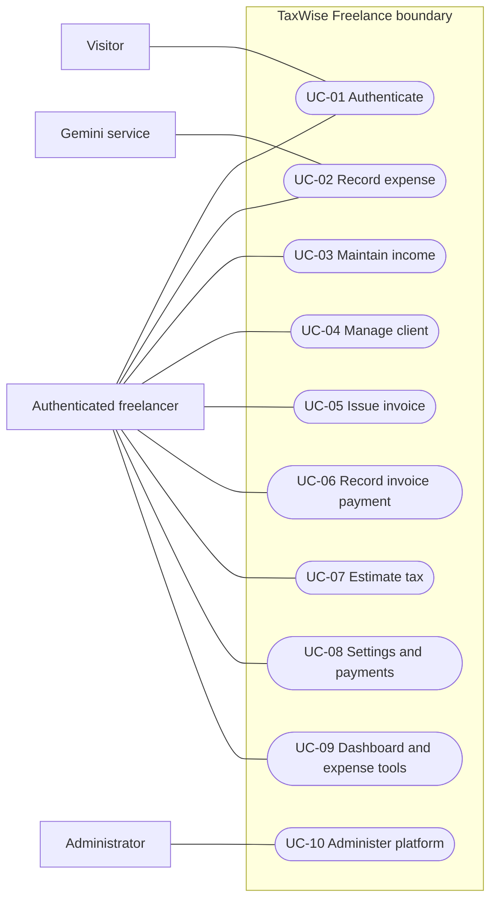

# Week 2 — software requirements specification

## 1. Introduction

### 1.1 Purpose

This IEEE 830-style SRS specifies TaxWise Freelance (PTUT-PRJ-042) for the student implementation team, academic reviewers, and acceptance testers. “Shall” denotes a verifiable requirement. The source authority is [PROJECT.md](../orchestration/PROJECT.md); this document specifies intended behaviour rather than certifying an implementation.

### 1.2 Scope

The web app shall integrate expense deductions, received income, federal estimated taxes, invoicing, and a dashboard. Weeks 8–9 extend the MVP with category suggestions, list tools, CSV/batch operations, administration, and polished responsive states. Tax rules are US federal 2026 only initially, behind a year/jurisdiction interface. Banking, payment processing, return filing, state/local taxes, payroll, receipt OCR, foreign exchange, and accountant collaboration are outside scope.

### 1.3 Definitions and references

| Term | Definition |
| --- | --- |
| Tenant | One authenticated user's isolated financial records |
| YTD | Selected tax year's start through the calculation's as-of date |
| SE / QBI | Self-employment / qualified business income |
| MFJ / HoH | Married filing jointly / head of household |
| Safe harbour | Project payment target based on 100% or 110% of prior-year total tax |
| Paid income | Cash receipt entered manually or generated from an invoice payment |
| RBAC | Role-based access control: USER or ADMIN |
| p95 | Value below which 95% of measured observations fall |

References: [week 1 discovery](week-01-problem-discovery.md), [architecture](week-03-architecture.md), [contracts and data design](week-04-database-api-wireframes.md). IEEE 830 supplies the document structure; no formal standards certification is claimed.

## 2. Overall description

### 2.1 Product perspective and functions

A browser client calls Next.js server APIs, which validate and authorise requests before accessing PostgreSQL through Prisma. A pure tax library computes estimates without database or network access. Gemini provides optional category suggestions; deterministic keyword classification remains available if it is unavailable. The product is a single-user financial workspace per tenant, plus a restricted platform administration surface.

### 2.2 Users and environment

Freelancers use phones and desktops with differing financial knowledge. Administrators manage accounts and review audit/aggregate platform activity; this role does not grant routine access to another user's financial records. The runtime is Node 20+, Next.js App Router, TypeScript, Tailwind, Recharts, PostgreSQL, and Prisma. Production targets Vercel and Neon; development uses Docker PostgreSQL. Current stable desktop and mobile browsers with JavaScript enabled are the verification targets; record exact versions during acceptance testing.

### 2.3 Constraints, assumptions, dependencies

- All money shall use integer cents; the initial calculation currency is USD. Invoice currency is presentation metadata for a single currency per user; no exchange conversion is implied.
- Data is manually supplied. The simplified estimator assumes self-employment income without wages, withholding, credits, capital gains, or spouse income; unsupported situations require a visible limitation notice.
- Prior-year tax and AGI are user supplied. Missing values make safe harbour unavailable rather than silently zero.
- QBI is the simplified below-threshold model in the project spec; above-threshold eligibility and phase-ins are unsupported and must be flagged rather than portrayed as complete.
- Credentials, database access, and optional Gemini credentials are deployment dependencies. A missing Gemini key shall not prevent expense entry.
- Academic deployment targets zero provider spend within free allowances; service targets are engineering objectives, not free-tier SLAs.

## 3. Specific requirements

### 3.1 Functional requirements

| ID / phase | Requirement and acceptance evidence |
| --- | --- |
| FR-01 / MVP | The system shall sign up, log in, log out, return the current user, and protect private routes. An inactive account or invalid/expired/revoked session shall be rejected. Duplicate signup, invalid credentials, and throttling have defined errors. |
| FR-02 / MVP | Users shall CRUD expenses with date, vendor, positive amount, category, notes, business use (0–100%), and payment method. Deduction = amount × business-use fraction × category factor, rounded to cents. Meals factor is 0.5; other model categories default to 1. Test mixed-use, zero-business-use, and invalid values. |
| FR-03 / MVP | Users shall CRUD manual income with date, source, amount, and notes. Invoice-linked income shall be created exactly once on payment and protected from manual changes that break invoice consistency. |
| FR-04 / MVP | The system shall produce a versioned estimate with YTD and annualised net profit, SE tax, half-SE deduction, simplified QBI, standard deduction, bracket income tax, total liability, method, amounts paid, remaining target, suggested quarterly payment, assumptions, and next due date. Tests shall cover each filing status, bracket boundary, zero/negative profit, and supported year. |
| FR-05 / MVP | Users shall CRUD clients and draft invoices, manage line items, apply invoice-level discount/tax, obtain atomic per-user numbering, mark sent/paid/void, observe overdue status, and print an invoice. Mark-paid shall create linked income atomically and idempotently. Paid/void invoices shall not be silently edited. |
| FR-06 / MVP | Users shall maintain tax settings and CRUD estimated payments. Safe harbour shall apply 110% if prior AGI > $150,000 and 100% otherwise, for the supported project statuses. Missing prior-year inputs disable this method. Records shall specify year, payment date, amount, and quarter. |
| FR-07 / MVP | The dashboard shall show YTD income, gross expenses, deductions, estimated tax owed, next payment date, monthly income/expense and category-deduction charts, outstanding invoices, and deadlines. Totals shall reconcile with source lists under the same date/year filters. |
| FR-08 / MVP | All domain operations shall scope reads/writes by authenticated user ID; forged ownership inputs shall not transfer ownership. Other users' IDs shall yield a non-disclosing not-found result. Administrative permissions are separate, explicitly checked capabilities. |
| FR-09 / weeks 8–9 | Lists shall provide allowlisted sorting, date/category/status filtering where applicable, search, and pagination. Expenses shall support atomic owned-record batch delete/reclassification and validated CSV import/export. Bad CSV imports shall report row errors without partial insertion. |
| FR-10 / weeks 8–9 | The system shall suggest an expense category using Gemini when configured, falling back to deterministic keywords on missing key, timeout, invalid output, or API failure. The user shall confirm/change suggestions; no suggestion blocks saving. |
| FR-11 / weeks 8–9 | ADMIN users shall list accounts, activate/deactivate them, change roles, inspect aggregate analytics, and read audit logs. Sensitive changes shall be audited; ordinary users cannot invoke these routes. Self-deactivation/demotion that would lock out the acting admin shall be rejected in this design. |
| FR-12 / MVP and polish | Users shall edit business name/address/currency and filing status/year/prior-year inputs. The UI shall supply empty/loading/error states, responsive layouts, accessible feedback, and an estimates-only disclaimer beside tax outputs. |
| FR-13 / infrastructure | GET /api/health shall report minimal app/DB availability without credentials or infrastructure details. CI shall run install, Prisma generation, lint, typecheck, coverage tests, and build; deployment shall apply migrations. |

### 3.2 Tax calculation contract

Rules shall be versioned in `src/lib/tax/rules/2026.ts`, with framework-free functions under `src/lib/tax/`. The following values are transcribed from PROJECT.md, not independently validated tax guidance.

| Parameter | Single | MFJ | HoH |
| --- | --- | --- | --- |
| Standard deduction (USD) | 16,100 | 32,200 | 24,150 |
| Upper bounds at 10%, 12%, 22%, 24%, 32%, 35% (USD) | 12,400; 50,400; 105,700; 201,775; 256,225; 640,600 | 24,800; 100,800; 211,400; 403,550; 512,450; 768,700 | 17,700; 67,450; 105,700; 201,750; 256,200; 640,600 |
| Marginal rate above final bound | 37% | 37% | 37% |
| Additional Medicare threshold (USD) | 200,000 | 250,000 | 200,000 |

Proposed deterministic calculation policy for implementation:

1. YTD net profit = received income minus computed deductible expenses. Gross expenses remain a separate reporting total.
2. Annualised profit = YTD net profit × days in selected year / elapsed calendar days, inclusive of the calculation date. The calculation date is min(as-of, December 31 of the selected year); a completed year uses factor 1. Reject as-of before the selected year starts. An as-of after year end is allowed for January's fourth instalment and overdue displays: stop financial aggregation at December 31, but include selected-tax-year payments through the original as-of date. This straight-line forecast is not the IRS annualised-income instalment method.
3. SE net earnings = max(0, annualised profit) × 92.35%. Base SE tax = 12.4% × min(net earnings, $184,500) + 2.9% × net earnings. Additional Medicare = 0.9% × max(0, net earnings − filing-status threshold). Half-SE deduction excludes additional Medicare.
4. QBI base = max(0, annualised profit − half-SE deduction). Taxable income before QBI = max(0, annualised profit − half-SE deduction − standard deduction). QBI deduction = min(20% of QBI base, 20% of taxable income before QBI), subject to the stated simplified-model limitation.
5. Apply progressive brackets to max(0, taxable income before QBI − QBI deduction). Total forecast liability = federal income tax + base SE tax + additional Medicare. Also expose unannualised YTD components using the same pipeline with factor 1, clearly labelled as partial-year planning values.
6. Liability method annual payment target = 90% of forecast liability (a proposed planning policy); safe-harbour method target = prior-year tax × 100%/110%. Display total forecast liability separately so a payment target cannot be mistaken for full tax owed.
7. Calendar instalments use four equal target shares, with cent remainder assigned to the fourth. Cumulative amount due = max(0, shares through the next scheduled instalment − payments recorded through as-of). Show annual remaining target = max(0, annual target − recorded payments), overpayment separately, and divide remaining target by remaining instalments for a level-payment suggestion. After the final due date, next due date is null and any unpaid target is shown as overdue, not divided by zero.
8. Due dates are April 15, June 15, September 15, 2026 and January 15, 2027. A due date equal to as-of remains next due. January's fourth payment belongs to tax year 2026; future-dated payment records do not reduce an as-of estimate.

Amounts remain integer cents. Represent percentages as integer basis points, use exact integer/rational intermediate arithmetic, and round half-up at each named monetary output (deduction, annualised profit, SE components, half-SE, QBI components, per-bracket tax, and targets). Sum rounded bracket components; never use formatted currency strings for arithmetic. The annualisation, 90% policy, rounding, and instalment allocation above resolve design details not specified in PROJECT.md and require implementation tests and orchestrator review. No low-income SE filing threshold or other unstated tax rule is inferred.

### 3.3 External interfaces

| Interface | Contract |
| --- | --- |
| Browser | Responsive pages, keyboard navigation, labelled forms, USD formatting, ISO dates transported to API, print CSS for invoices |
| REST API | HTTPS JSON at `/api`, same-origin cookie authentication, Zod validation, consistent error envelope; multipart/text CSV only where documented |
| PostgreSQL / Prisma | Parameterised access through Prisma, migrations, tenant filters, transactions for invoice payment and numbering |
| Gemini | Server-side optional key, minimal vendor/description text, bounded timeout, allowlisted category response, no auth tokens or customer invoice data sent |
| Deployment / CI | GitHub Actions verifies code; Vercel runs app/migrations; Neon supplies DATABASE_URL. Secrets are environment values, never browser payloads. |

### 3.4 Quantifiable nonfunctional requirements

| ID | Requirement | Verification / conditions |
| --- | --- | --- |
| NFR-01 | Warm authenticated API p95 latency < 300 ms | Measure 1,000 ordinary CRUD/list requests at 10 concurrent users against 10,000 expenses per tenant in the configured deployment region. Report cold starts separately. CSV, external AI, builds and migrations excluded; dashboard/estimate included. |
| NFR-02 | Availability target ≥ 99.5% per calendar month | External synthetic health checks every minute; successful app+DB checks / scheduled checks. Free tiers may not sustain the target; report misses and maintenance rather than claiming an SLA. |
| NFR-03 | Password hashing shall use bcrypt cost 12; JWTs HS256 with jose shall expire in 7 days | Unit/integration tests inspect hash cost, expiry, signature rejection, and cookie attributes: httpOnly, Secure in production, SameSite=Lax, Path=/. |
| NFR-04 | Apply controls against OWASP Top 10 risks | Review access control, injection, authentication, cryptography, misconfiguration, dependency integrity, logging, and server-side request handling; tenant/role tests, Zod negative cases, dependency audit and header checks. No claim of certification. |
| NFR-05 | Mutations shall enforce same-origin checks; auth routes shall rate-limit | Reject missing/mismatched Origin for browser mutations. Proposed limits: 5 login attempts per 15 minutes per IP+normalised email and 10 signups/hour/IP; respond 429 with Retry-After. Distributed deployment requires shared limiter state. |
| NFR-06 | UI shall meet WCAG 2.1 AA | Automated accessibility checks plus keyboard, focus, labels, error announcements, chart text alternatives, 200% zoom, and contrast review on all six screens. No essential colour-only communication. |
| NFR-07 | Core layouts shall work from 320 px to 1440 px viewport width | No page-level horizontal overflow; wide data tables may use labelled scroll regions or cards. Verify forms and dialogs with keyboard/mobile emulation. |
| NFR-08 | `src/lib` coverage shall be ≥ 70% | Vitest coverage gate for statements, branches, functions, and lines as a proposed interpretation; include tax boundaries, auth, validation, and AI fallback. |
| NFR-09 | Money/ownership integrity shall hold under retries and concurrency | Integration tests submit concurrent invoice-number allocation and mark-paid requests; unique constraints and transactions prevent duplicate income and cross-tenant references. |
| NFR-10 | Security headers and audit records shall be present | Verify CSP, HSTS in production, X-Frame-Options, nosniff, and referrer policy; audit successful login, sensitive deletes, role/status changes. Logs exclude passwords, JWTs and full request bodies. |
| NFR-11 | AI shall not block expense entry; suggestion response ≤ 3 seconds application timeout | Simulate unavailable, slow, malformed, and unconfigured provider; return deterministic fallback with provenance. User can save without requesting AI. |
| NFR-12 | Tax functions shall be deterministic and isolated from I/O | Unit tests with explicit year/as-of inputs; no DB, network, global clock, or framework imports in calculation functions. |

## 4. Formal use cases

### UC-01 — establish an authenticated workspace (FR-01)

- **Actors:** Visitor; authentication service.
- **Preconditions:** Visitor is unauthenticated; signup is enabled.
- **Main flow:** (1) Visitor enters email/password at signup. (2) Server validates and normalises email, checks rate limits, hashes password at cost 12, and creates user/settings. (3) Server issues JWT cookie and records a session. (4) User reaches dashboard; later logins verify the hash and issue a new session.
- **Alternate flows:** Existing email → 409; invalid input → 422; wrong credentials/inactive user → generic 401; throttling → 429. Invalid/expired sessions route to login. Logout revokes the current session and clears the cookie.
- **Postconditions:** Successful user has an isolated authenticated workspace; failure creates no partial account or session.

### UC-02 — record a deductible expense (FR-02, FR-10)

- **Actors:** Authenticated user; optional Gemini service.
- **Preconditions:** Active session and supported category catalogue.
- **Main flow:** (1) Enter purchase fields. (2) Optionally request category suggestion and confirm category. (3) Server validates ownership-independent inputs and calculates deduction. (4) Save and refresh list/dashboard totals.
- **Alternate flows:** AI unavailable → keyword fallback; invalid amount/business share → field error without save; session expired → 401; missing record on edit → 404.
- **Postconditions:** One owned expense exists with deterministic deductible amount; suggestion provenance does not establish tax eligibility.

### UC-03 — maintain manual income (FR-03)

- **Actors:** Authenticated user.
- **Preconditions:** Active session; a receipt occurred.
- **Main flow:** (1) Enter receipt date, source, amount, notes. (2) Validate and save. (3) Inspect updated income and dashboard. (4) Correct or delete the manual record when necessary.
- **Alternate flows:** Nonpositive amount → 422; invoice-linked record edit/delete → 409 with instruction to use invoice workflow; foreign ID → 404.
- **Postconditions:** Received income reflects the manual record exactly once; invoice linkage remains intact.

### UC-04 — manage a client (FR-05)

- **Actors:** Authenticated user.
- **Preconditions:** Active session.
- **Main flow:** (1) Open clients. (2) Enter name and optional contact/billing details. (3) Save. (4) Select client in invoice editor; update details later if needed.
- **Alternate flows:** Invalid email → 422; foreign/missing client → 404; delete client referenced by invoice → 409, preserving invoice history.
- **Postconditions:** An owned client record is available; issued invoices retain snapshots of billing details.

### UC-05 — compose and issue an invoice (FR-05)

- **Actors:** Authenticated user; client as recipient outside the app.
- **Preconditions:** Active session; owned client exists; issuer settings are configured.
- **Main flow:** (1) Add line items and due date. (2) Apply optional discount/tax. (3) Server allocates a unique per-user number and computes totals. (4) Save draft, then mark sent. (5) Open printable view and use browser Save as PDF/share externally.
- **Alternate flows:** Invalid lines/discount → 422; number contention → transactional retry; edits to sent/paid/void invoices → 409; expired sent due date displays overdue. Email delivery is outside scope.
- **Postconditions:** Invoice has stable number, snapshots, totals, and controlled status; no income exists until paid.

### UC-06 — record an invoice payment (FR-03, FR-05)

- **Actors:** Authenticated user.
- **Preconditions:** Owned invoice is sent or overdue; full payment has been received.
- **Main flow:** (1) Select mark paid and payment date. (2) Server locks/conditionally updates invoice. (3) In one transaction set PAID and insert linked income. (4) Return updated invoice and income reference.
- **Alternate flows:** Retry on paid invoice → return existing result; concurrent request → one linked record; draft/void invoice → 409; invalid date → 422; transaction failure → rollback both writes.
- **Postconditions:** Invoice and exactly one income record agree. Partial payments and paid-invoice reversal are outside this design.

### UC-07 — calculate quarterly estimates (FR-04)

- **Actors:** Authenticated user; pure tax engine.
- **Preconditions:** Supported tax year/filing status, valid as-of date, owned financial records.
- **Main flow:** (1) Choose as-of date and liability or safe-harbour method. (2) Server gathers owned YTD records/settings. (3) Pure engine applies versioned rules. (4) UI shows components, assumptions, payments, target, next due date, and disclaimer.
- **Alternate flows:** Missing prior-year values → 422 for safe harbour; unsupported year → 422; zero/loss profit → nonnegative taxable amounts; unsupported tax circumstances → explicit limitations; final due date passed → overdue balance and null next date.
- **Postconditions:** Reproducible planning estimate is returned; calculation does not mutate financial records.

### UC-08 — configure tax profile and log payments (FR-06, FR-12)

- **Actors:** Authenticated user.
- **Preconditions:** Active session; user has their own relevant figures.
- **Main flow:** (1) Save filing status, year, optional prior tax/AGI and issuer details. (2) Enter payment amount/date/quarter/tax year. (3) Server validates and saves. (4) Recalculate estimate; show reconciled remaining target.
- **Alternate flows:** Missing required profile data → field errors; payment outside selected tax year calendar may be valid (January Q4); future payment excluded from earlier as-of estimates; correction/delete refreshes totals; foreign payment ID → 404.
- **Postconditions:** Profile and payment history persist; January fourth-instalment attribution is preserved.

### UC-09 — inspect dashboard and organise expenses (FR-07, FR-09)

- **Actors:** Authenticated user.
- **Preconditions:** Active session; zero or more records.
- **Main flow:** (1) Select year and view KPIs/charts/deadlines. (2) Open expense list, filter/search/sort/page. (3) Select owned rows for reclassification/deletion, or import/export CSV. (4) Server validates the full operation and refreshes affected totals.
- **Alternate flows:** No data → helpful empty states; CSV row errors → reject whole import with row details; any foreign/missing batch ID → 404 and no changes; temporary API failure → retry state retaining filters.
- **Postconditions:** Summaries reconcile with saved records; export respects the same filters and tenant.

### UC-10 — administer platform access (FR-11)

- **Actors:** Active ADMIN.
- **Preconditions:** Valid session and current database role ADMIN.
- **Main flow:** (1) Inspect paginated users and aggregate analytics. (2) Change a target user's role or active status. (3) Server checks constraints and saves change plus audit record atomically. (4) Inspect audit log.
- **Alternate flows:** USER → 403; foreign-domain financial access remains disallowed; self-demotion/self-deactivation → 409; deactivation revokes target sessions; missing account → 404.
- **Postconditions:** Authorised account change is traceable; revoked/deactivated access cannot continue using an old JWT.

## 5. Use case diagram

Mermaid flowchart notation represents actors and oval use cases because Mermaid has no native UML use-case grammar. Edges show participation, not data flow.

