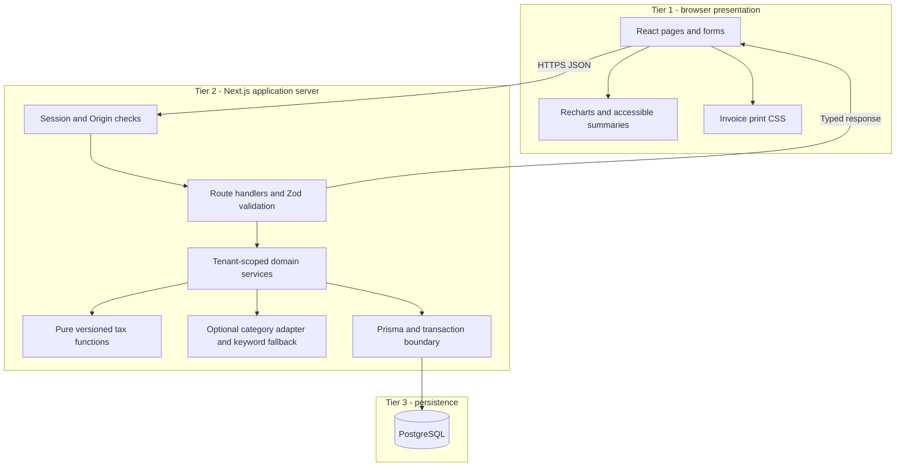
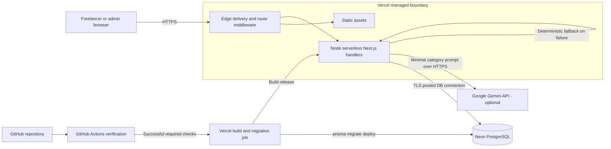
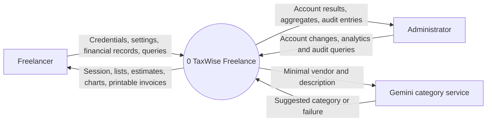
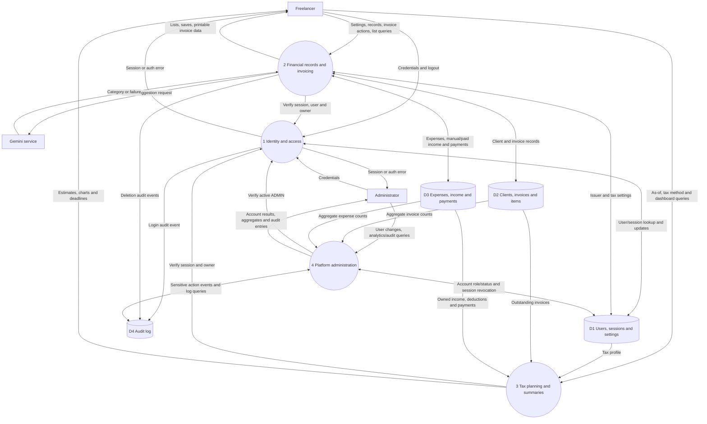

# Week 3 — architecture and cloud design

## 1. Architectural intent

TaxWise Freelance uses three logical tiers within a Next.js deployment: browser presentation, server application/API, and PostgreSQL persistence. Separating these responsibilities lets the team test tax calculations without a running web server, enforce tenant ownership centrally at the application boundary, and migrate the database independently. Route handlers or server actions may implement application operations; the [week 4 REST contracts](week-04-database-api-wireframes.md) are the reviewable HTTP design.

## 2. Cloud topology and deployment

The CI pipeline shall install locked npm dependencies, generate Prisma client, lint, typecheck, test with coverage, and build. Production releases should be gated on these checks. Vercel's build runs `prisma migrate deploy` before release against the intended environment; preview environments must not run experimental migrations against the production database. Coordinate migration access/connection settings with Neon and use backward-compatible migrations because old and new functions can overlap during deployment.

Middleware provides early route protection. Every handler still validates the signed cookie and current session/user state; middleware is not the ownership boundary. Bcrypt, Prisma, and tax services execute in the Node server runtime, not edge middleware. Serverless handlers are stateless: sessions, counters, audit records, and distributed rate-limit state must not depend on process memory. Use provider-compatible pooled database connections and keep functions and DB geographically close.

Environment configuration follows PROJECT.md: `DATABASE_URL`, `JWT_SECRET`, optional `GEMINI_API_KEY`, `ADMIN_EMAILS`, and `APP_URL`. Only server code reads secrets; `.env.example` describes names without values. `ADMIN_EMAILS` is trusted deployment configuration used to assign initial signup roles, not a browser-supplied privilege flag. TLS terminates at managed providers. HSTS and the other security headers are configured on the app responses.

## 3. DFD level 0 — context

This context diagram treats the product as a single process. Clients receive invoice documents outside the app; the system neither emails invoices nor processes money.

## 4. DFD level 1 — application processes and stores

Each D1–D4 store is a logical partition of the same PostgreSQL database. The external entities and flows balance with level 0; internal flows expose how those outputs are derived.

## 5. Boundaries and invariants

| Boundary | Enforcement and consequence |
| --- | --- |
| Browser → API | Browser input is untrusted. Zod rejects invalid/unknown privileged fields; server derives userId from the session. Origin checks protect cookie-authenticated mutations. Client-only validation is supplementary. |
| Authentication → authorisation | JWT signature/expiry plus stored session revocation and active user checks precede every private operation. ADMIN privileges come from current server-side user state; stale role claims do not grant access. |
| Tenant → tenant | Every domain query includes userId; related clients/invoices must belong to that same user. Composite references and ownership checks reject cross-tenant object relationships. Missing and foreign IDs return the same 404 shape. |
| Domain service → persistence | Atomic transactions combine number allocation, invoice snapshots, payment status and linked income. A unique invoice-income relationship handles retries. No database access occurs from the browser. |
| Tax engine → environment | Tax engine accepts explicit records/rules/as-of inputs and returns values without I/O. Year data is versioned; unsupported years fail clearly. Assumptions and rounding are specified in the SRS. |
| Application → Gemini | Only vendor/description needed for categorisation leaves the service. A timeout, allowlisted response, and deterministic fallback prevent provider failures from blocking expense entry. Do not transmit invoice/client details or secrets. |
| Administration → financial workspace | Admin routes expose user management, platform aggregates and audit metadata. They do not bypass tenant filters on ordinary finance endpoints. Sensitive account changes are audited and revocation is immediate. |
| Operational systems → secrets | CI/deployment secrets remain in provider settings; application logs redact passwords, tokens, database URLs and personal financial payloads. Health checks expose only app/DB state. |

### Critical transaction example: mark invoice paid

Authenticate → select invoice by `(userId, id)` → check current state → update PAID/paidAt and insert Income with unique invoiceId → commit → return. If the invoice is already paid, return its existing linked income. A failure rolls back both writes. Concurrent requests must resolve to the same result through a row lock or conditional update plus a unique constraint; application prechecks alone do not prevent races.

## 6. Stack choice and alternatives

The comparison is an architectural assessment for this project, not a current provider feature/pricing survey. The selected stack is mandated by PROJECT.md. Alternatives are evaluated by migration effort and fit, not assumed defects.

| Option | Fit for this design | Tradeoff relative to selected plan | Cost treatment |
| --- | --- | --- | --- |
| **Vercel + Neon (selected)** | Next.js delivery plus PostgreSQL/Prisma relational model; deployment integrates with the specified workflow | Serverless cold starts, connection management, migrations and free allowances need monitoring | Plan $0 using eligible free allowances; verify before deployment |
| Render-based hosting | Can host a conventional Node service with a separately configured database | Requires adapting release/hosting configuration and reviewing service lifecycle and DB plans; long-running service model may simplify local parity | No alternative price asserted; evaluate current offers if selected |
| Supabase-based backend | Relational Postgres is compatible with the data model | Its optional auth/API services would duplicate the specified JWT/Prisma tier unless the architecture were revised | Check current project, compute, storage and egress allowances |
| Railway-based hosting | App and relational database deployment can follow a service model | Different billing/release model and operational setup; changes the mandated deployment target | Check current trial/credit and recurring charges; do not assume perpetual $0 |
| Firebase-based backend | Managed app services could support a revised web architecture | A document-store implementation would require redesigning relational constraints, joins and transaction patterns; adopting its auth would replace custom auth | Check selected Firebase products and quotas; no zero-cost guarantee |

Next.js/TypeScript shares types across UI and handlers. Prisma provides typed relational access and migrations. PostgreSQL suits invoice line items, ownership references and atomic payment recording. Tailwind supports consistent responsive forms; Recharts supplies the specified dashboard charts, supplemented by accessible textual summaries. Vitest isolates calculation and utility tests from framework deployment. None of these choices alone guarantees tenant isolation, accessibility or correct tax results; the SRS tests those properties explicitly.

## 7. $0 academic deployment budget

| Component | Planned monthly spend | Constraint / action |
| --- | --- | --- |
| Vercel app and included deployment hostname | $0 | Stay within an eligible free plan's execution, bandwidth and build allowances; no purchased domain |
| Neon PostgreSQL | $0 | Small demo dataset, bounded connections/storage; inspect inactivity and quota behaviour before release |
| GitHub Actions | $0 | Use included eligible CI allowance; bound job frequency and retention |
| Gemini | $0 | Optional only if eligible no-charge usage is available; otherwise omit key and use keyword fallback |
| Local development | $0 incremental provider charges | Existing computer, Node/npm and local Docker PostgreSQL; hardware/internet costs excluded |
| **Total planned provider spend** | **$0** | No paid plan or overage authorisation is implied |

Prices, plan eligibility, quotas and commercial-use conditions are not verified by this design exercise. At week 11, record the actual plans/limits, disable paid upgrades where possible, and test quota failure handling. Use a small seeded dataset and manual deployment if CI allowance is constrained. If any required service cannot meet the budget or NFR targets, record the conflict for the orchestrator; do not quietly claim both zero cost and production reliability.

## 8. Failure and recovery design

- A DB failure causes a bounded API error and health 503; the UI preserves unsaved input and offers retry. Never report a successful write before commit.
- Gemini failure yields a keyword suggestion with provenance; saving an expense does not depend on it.
- A cold start may miss the latency objective; measure and report it separately and evaluate region/connection configuration before changing providers.
- Deployment verifies migrations before release. Use forward-compatible schema evolution and a documented database backup/export before risky changes. Backup retention and restore behaviour must be confirmed for the selected plan; no recovery SLA is assumed.
- Audit recording for sensitive mutations belongs to the transaction. CSV/batch limits bound execution time and memory. Financial CSV exports provide a user-controlled data copy, but are not a complete database backup.
