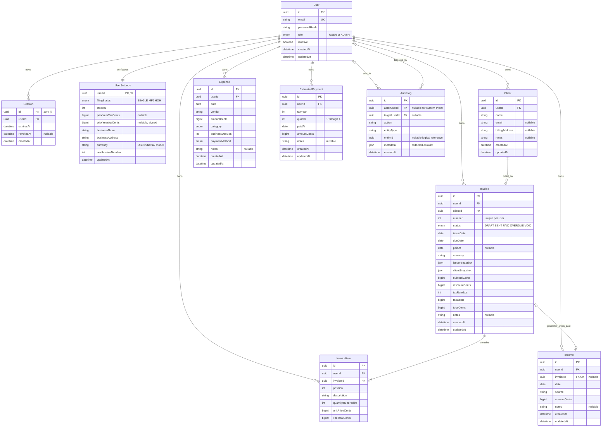

# Week 4 — database, API contracts, and wireframes

## 1. Data design conventions

This is a proposed logical design consistent with PROJECT.md, not a reverse-engineered implementation schema. IDs are UUIDs. Monetary columns are integer cents using a database integer type large enough for the validated API bounds (prefer BIGINT); JSON encodes only safe integer values. Percentages use basis points (10,000 = 100%). Date-only business events use SQL DATE; created/updated/session/audit instants use UTC timestamptz. Every mutable entity has createdAt/updatedAt unless shown as append-only. A financial tax year is explicit where it cannot be inferred reliably from the event date.

All financial entities carry userId. InvoiceItem also carries userId even though ownership can be inferred, enabling explicit tenant constraints. Session belongs to a user; AuditLog carries nullable actorUserId and targetUserId instead of treating cross-user admin events as one tenant's finance rows. Settings (including tax profile) is a single one-to-one UserSettings record. Tax rules and the category catalogue are versioned code data, not mutable tax tables.

### 1.1 Entity relationship diagram



Invoice-to-income is an optional one-to-one relationship: manual income has no invoice, and unpaid invoices have no income. The diagram's minimum-one item means persisted valid invoices require at least one item; creating a temporary empty editor need not create a database row. User and settings are created in one transaction.

### 1.2 Integrity, derivations, and lifecycle

- Normalise email to trimmed lowercase before enforcing uniqueness. Hash passwords using bcrypt cost 12. The JWT contains sub, jti, issued-at and expiry; store no raw JWT or password in Session. Check Session.expiresAt/revokedAt and User.isActive on each authenticated request.
- Add unique `(userId,id)` keys to Client and Invoice for composite references. Invoice `(userId,clientId)` references Client `(userId,id)`; InvoiceItem and Income `(userId,invoiceId)` reference Invoice `(userId,id)`. This prevents linking a record to another tenant even if an application check is missed. Owner userId references User on every owned table.
- Expense deduction is derived from stored amount, businessUseBps and the selected year's category factor; do not store a stale calculated deduction. A response includes the rule version and computed amount. The category code maps to Schedule C reporting treatment; Home office requires worksheet/form treatment rather than a fabricated direct line.
- Category codes: `ADVERTISING`, `CAR_TRUCK`, `CONTRACT_LABOR`, `INSURANCE`, `LEGAL_PROFESSIONAL`, `OFFICE`, `RENT_LEASE`, `SUPPLIES`, `TRAVEL`, `MEALS`, `UTILITIES`, `SOFTWARE`, `HOME_OFFICE`, `EDUCATION`, `OTHER`. Payment methods: `CASH`, `CARD`, `BANK_TRANSFER`, `OTHER`. Tax engine factors follow PROJECT.md, with eligibility limitations in the SRS.
- Check constraints enforce positive financial entry amounts, 0–10,000 businessUseBps/taxRateBps, quarter 1–4, nonnegative invoice discount/prices, positive quantities, and dueDate ≥ issueDate. Prior-year AGI is signed; prior-year tax is nonnegative or null. Enforce cross-field totals in the service transaction.
- Item quantity uses hundredths (e.g., 150 = 1.50). Line total = round-half-up(quantityHundredths × unitPriceCents / 100). Subtotal is the sum of line totals; fixed discount ≤ subtotal; tax = round-half-up((subtotal − discount) × taxRateBps / 10,000); total = subtotal − discount + tax. Total must be positive. Mixed-rate line taxation, refunds, and percentage discounts are outside this design.
- Allocate number by atomically incrementing UserSettings.nextInvoiceNumber in the invoice creation transaction. Unique `(userId,number)` is a final concurrency guard; numbers are never reused, including void/deleted drafts. Number rendering may prefix `INV-` without changing numeric uniqueness.
- Drafts permit edits/deletion; SENT permits mark-paid or void. OVERDUE is SENT with dueDate before today and participates in those same actions. PAID and VOID are terminal here. Never mutate status merely by reading: derive effective OVERDUE in queries/responses from SENT; if persisted OVERDUE exists, reconcile under the same rule. Filter/dashboard logic must use effective status consistently.
- Mark-paid inserts unique linked Income and sets PAID/paidAt in one transaction; retries return the existing result. Manual income mutation is forbidden for invoice-linked rows. No partial payment or paid reversal route is proposed.
- Invoice snapshots freeze issuer/client details on sending; draft snapshots may refresh on edit. Print sent invoices from snapshots so later client edits do not change historical documents. Print layout is a browser route, not server PDF generation.
- Client deletion is RESTRICT while invoices reference it. Invoice deletion is allowed only for drafts and cascades items; linked income would restrict deletion. Delete finance rows through audited application operations. Account deletion is outside scope; deactivation retains records and revokes sessions. Audit actor/target FKs use SET NULL if a future retention process removes accounts. Session rows may cascade on account removal.

### 1.3 Explicit index definitions

`UNIQUE` indexes also enforce constraints. PostgreSQL does not automatically index every FK; these indexes support the expected predicates. Avoid adding indexes for fields with no query need.

| Table / index name | Definition | Justification |
| --- | --- | --- |
| User / user_email_uq | UNIQUE(email) | Signup deduplication and login lookup after normalisation |
| User / user_created_id_idx | (createdAt DESC, id) | Admin signup chart and stable user pagination |
| Session / session_pk | PRIMARY KEY(id) | Resolve JWT jti without token storage |
| Session / session_user_expiry_idx | (userId, expiresAt) | Revoke a user's sessions and enumerate live sessions |
| Session / session_expiry_idx | (expiresAt) | Expired-session cleanup |
| UserSettings / settings_pk | PRIMARY KEY(userId) | One profile/counter row per user |
| Client / client_owner_id_uq | UNIQUE(userId, id) | Composite ownership FK target |
| Client / client_owner_name_idx | (userId, name, id) | Tenant client ordering and prefix search |
| Invoice / invoice_owner_id_uq | UNIQUE(userId, id) | Composite ownership FK target |
| Invoice / invoice_owner_number_uq | UNIQUE(userId, number) | Atomic numbering constraint and number lookup |
| Invoice / invoice_owner_status_due_idx | (userId, status, dueDate, id) | Outstanding/overdue lists and dashboard |
| Invoice / invoice_owner_client_idx | (userId, clientId) | Client history and deletion-reference checks |
| Invoice / invoice_owner_issue_idx | (userId, issueDate DESC, id) | Date-filtered chronological list |
| InvoiceItem / item_position_uq | UNIQUE(userId, invoiceId, position) | Item retrieval and stable order without repeated positions |
| Expense / expense_owner_date_idx | (userId, date DESC, id) | YTD aggregation, date range and stable pagination |
| Expense / expense_owner_category_date_idx | (userId, category, date DESC, id) | Category-filtered lists and deduction summaries |
| Income / income_invoice_uq | UNIQUE(invoiceId) | Exactly one receipt per paid invoice; multiple null manual entries allowed |
| Income / income_owner_date_idx | (userId, date DESC, id) | Income lists and YTD/monthly aggregation |
| EstimatedPayment / payment_owner_year_date_idx | (userId, taxYear, paidAt, id) | Tax-year totals with as-of cutoff; Q4 can be paid next calendar year |
| AuditLog / audit_created_id_idx | (createdAt DESC, id) | Admin global log pagination |
| AuditLog / audit_actor_date_idx | (actorUserId, createdAt DESC, id) | Actor-filtered audit investigation |
| AuditLog / audit_target_date_idx | (targetUserId, createdAt DESC, id) | Target account investigation |

Each entity also has its declared PK; duplicate standalone ID indexes are unnecessary. Substring search uses bounded tenant queries initially; a B-tree name index is not claimed to accelerate arbitrary contains queries. Add specialised search indexes only after measured need. The shared rate limiter may need a separate bounded operational store/table; it is not a financial entity and must not rely solely on ephemeral server memory.

## 2. REST API conventions and reusable schemas

The following schemas are normative shorthand for this design. All object properties listed without `?` are required. PATCH schemas permit a nonempty subset of mutable fields. Unknown input fields (especially userId, role, status, totals and linkage fields) are rejected. No client chooses ownership. All successful JSON responses use `{ data: T }`; list responses also have `meta`. Errors use `{ error: { code, message, details? } }` and never include stack traces or secrets.

### 2.1 Primitives, auth, errors and pagination

| Name | Definition |
| --- | --- |
| Id / Date / Instant | UUID string / valid `YYYY-MM-DD` / RFC 3339 UTC timestamp |
| Money | Integer cents, 0–1,000,000,000,000 for individual supplied values; entry amounts must be ≥ 1. Reject results outside JSON safe integer range. |
| Text / Note | Trimmed 1–200 characters / optional text up to 2,000 characters; address ≤ 1,000 |
| Email / Password | Normalised valid email ≤ 254 chars / 12+ characters and ≤ 72 UTF-8 bytes (bcrypt input limit), never returned |
| Year / FilingStatus | Initially 2026 only / `SINGLE` \| `MFJ` \| `HOH` |
| Category / PaymentMethod | Enumerations in §1.2 |
| PageQuery | `page` integer ≥ 1 default 1; `pageSize` 1–100 default 20; `sort` endpoint allowlist; `order=asc\|desc`. Sort ties always use id. |
| `List<T>` | `{data:T[], meta:{page,pageSize,total,totalPages}}`; totalPages = ceil(total/pageSize), including 0 for empty results |
| DateQuery | Optional inclusive `from`, `to`; reject from > to; default selected tax year where stated |
| TimeRange | Required `from`, `to` valid dates, at most 366 days for admin analytics |
| Auth V / U / A | Visitor/public / active session user / active session ADMIN. Auth still applies to print data routes. |
| CSRF policy | Every POST/PATCH/DELETE checks Origin against APP_URL, including signup/login; absent/mismatched Origin → 403. No CORS wildcard with credentials. GETs never mutate finance data. |
| Cookie | HS256 jose JWT; httpOnly; Secure in production; SameSite=Lax; Path=/; 7-day expiry. Server session revocation check required; no JWT returned in JSON. |

Common errors for **every** route unless impossible: `400 MALFORMED_REQUEST` (invalid JSON/query encoding), `422 VALIDATION_ERROR` (typed/schema errors, with field paths), `500 INTERNAL_ERROR`, `503 SERVICE_UNAVAILABLE` (e.g. DB unavailable). Private routes additionally return `401 UNAUTHENTICATED` for invalid/expired/revoked/inactive sessions. A routes return `403 FORBIDDEN` for non-admin; all mutations can return `403 ORIGIN_REJECTED`. ID lookups return `404 NOT_FOUND` for missing or foreign-owned records. Unexpected methods return `405 METHOD_NOT_ALLOWED`. Tables below add domain-specific errors; these common rules are part of each contract.

Validation details use `{fields:[{path,message}], rows?:[{row,field,message}]}` with bounded error counts. Rate-limited auth returns `429 RATE_LIMITED` plus Retry-After. Return only generic login errors for unknown email, bad password and inactive account. Deletion returns `200 {data:{id,deleted:true}}` unless a batch result is specified. No API silently truncates CSV data or silently accepts a partially valid batch.

### 2.2 Reusable object schemas

| Schema | Fields |
| --- | --- |
| UserView | `{id,email,role:USER\|ADMIN,isActive:boolean,createdAt:Instant}` |
| SettingsInput | `{filingStatus,taxYear,priorYearTaxCents:Money\|null,priorYearAgiCents:signed Money\|null,businessName:Text,businessAddress:string,currency:"USD"}`; signup may create empty issuer details until edited |
| SettingsView | SettingsInput plus `{userId,updatedAt:Instant}`; nextInvoiceNumber stays server-only |
| ExpenseInput | `{date:Date,vendor:Text,amountCents:positive Money,category:Category,businessUseBps:int[0,10000],paymentMethod:PaymentMethod,notes?:Note}` |
| ExpenseView | ExpenseInput plus `{id,userId,deductibleCents:Money,ruleVersion:string,createdAt:Instant,updatedAt:Instant}` |
| IncomeInput | `{date:Date,source:Text,amountCents:positive Money,notes?:Note}` |
| IncomeView | IncomeInput plus `{id,userId,invoiceId:Id\|null,createdAt:Instant,updatedAt:Instant}` |
| ClientInput | `{name:Text,email?:Email\|null,billingAddress?:string\|null,notes?:Note}` |
| ClientView | ClientInput plus `{id,userId,createdAt:Instant,updatedAt:Instant}` |
| ItemInput | `{description:Text,quantityHundredths:int[1,1000000],unitPriceCents:Money}`; 1–100 items per invoice, position from array order |
| ItemView | ItemInput plus `{id,position:int,lineTotalCents:Money}` |
| InvoiceInput | `{clientId:Id,issueDate:Date,dueDate:Date,items:ItemInput[],discountCents:Money,taxRateBps:int[0,10000],notes?:Note}`; draft edits may replace full item array |
| PartySnapshot | `{name:string,email?:string\|null,address:string}`; issuer email optional from user, client address may be empty |
| InvoiceSummary | `{id,userId,clientId,number:int,status:DRAFT\|SENT\|PAID\|OVERDUE\|VOID,issueDate,dueDate,paidAt:Date\|null,currency:"USD",subtotalCents,discountCents,taxRateBps,taxCents,totalCents,notes?:Note,createdAt,updatedAt}` |
| InvoiceView | InvoiceSummary plus `{items:ItemView[],issuerSnapshot:PartySnapshot,clientSnapshot:PartySnapshot,incomeId:Id\|null}` |
| PaymentInput | `{taxYear:Year,quarter:int[1,4],paidAt:Date,amountCents:positive Money,notes?:Note}` |
| PaymentView | PaymentInput plus `{id,userId,createdAt:Instant,updatedAt:Instant}` |
| TaxComponents | `{netProfitCents:signed Money,seNetEarningsCents,baseSeTaxCents,additionalMedicareCents,halfSeDeductionCents,qbiDeductionCents,standardDeductionCents,taxableIncomeCents,incomeTaxCents,totalLiabilityCents}`; unspecified numeric fields are nonnegative cents |
| EstimateView | `{taxYear,jurisdiction:"US_FEDERAL",ruleVersion,asOf:Date,filingStatus,method:LIABILITY\|SAFE_HARBOUR,annualisation:{elapsedDays:int,daysInYear:int},ytd:TaxComponents,annualised:TaxComponents,annualPaymentTargetCents,paidCents,remainingTargetCents,overpaidCents,quarterSharesCents:Money[4],cumulativeDueCents,suggestedNextPaymentCents,nextDueDate:Date\|null,overdueBalanceCents,assumptions:string[],warnings:string[],disclaimer:string}` |
| DashboardView | `{taxYear,asOf:Date,kpis:{incomeCents,expenseCents,deductionCents,estimatedTaxOwedCents,nextPaymentCents,nextDueDate:Date\|null},monthly:{month:string,incomeCents,expenseCents}[],deductionsByCategory:{category,deductionCents}[],outstandingInvoices:InvoiceSummary[],deadlines:{taxYear,quarter,dueDate:Date}[],warnings:string[]}` |
| AuditView | `{id,actorUserId:Id\|null,targetUserId:Id\|null,action:string,entityType:string,entityId:Id\|null,metadata:object,createdAt:Instant}`; metadata redacted allowlist |

All views have the types defined in this section even where primitive suffixes are omitted. UserId is output metadata, never an accepted input. List finance ranges compare date-only values; server computes today's business date consistently (UTC for this design) and returns asOf to avoid hidden browser timezone shifts. Dashboard uses liability method by default and `estimatedTaxOwedCents` means max(0, annualised total liability − payments through asOf); its payment recommendation is the estimator's target-based value, clearly labelled separately.

## 3. Complete endpoint contracts

### 3.1 Authentication and settings

| Method / path | Auth | Request schema | Success schema / status | Additional errors / behaviour |
| --- | --- | --- | --- | --- |
| POST `/api/auth/signup` | V | `{email:Email,password:Password}` | 201 `{data:UserView}`, sets cookie | 409 EMAIL_EXISTS; 429 RATE_LIMITED. Create settings/session transactionally; initial role from trusted ADMIN_EMAILS only. |
| POST `/api/auth/login` | V | `{email:Email,password:Password}` | 200 `{data:UserView}`, sets cookie | 401 INVALID_CREDENTIALS; 429 RATE_LIMITED; audit successful login |
| POST `/api/auth/logout` | U* | Empty object | 200 `{data:{loggedOut:true}}`, clears cookie | Idempotent: absent/expired cookie also succeeds; revoke existing session if present. Origin check applies. |
| GET `/api/auth/me` | U | None | 200 `{data:UserView}` | Current database role/status; never password hash |
| GET `/api/settings` | U | None | 200 `{data:SettingsView}` | Existing default profile returned |
| PATCH `/api/settings` | U | Nonempty partial SettingsInput | 200 `{data:SettingsView}` | 422 UNSUPPORTED_TAX_YEAR or unsupported currency; no role/counter mutation |

`U*` is the sole authentication exception for idempotent logout. Forgot-password, email verification and account deletion are not specified product features and have no implied endpoints.

### 3.2 Expenses, suggestions, batch and CSV

| Method / path | Auth | Request schema | Success schema / status | Additional errors / behaviour |
| --- | --- | --- | --- | --- |
| GET `/api/expenses` | U | PageQuery + DateQuery + `category?:Category,q?:string[1,100]`; sort `date,amountCents,vendor` | 200 `List<ExpenseView>` | Search vendor/notes; default date descending |
| POST `/api/expenses` | U | ExpenseInput | 201 `{data:ExpenseView}` | Calculated deduction returned |
| GET `/api/expenses/{id}` | U | Id path | 200 `{data:ExpenseView}` | 404 per ownership policy |
| PATCH `/api/expenses/{id}` | U | Id + partial ExpenseInput | 200 `{data:ExpenseView}` | Recompute deduction after any relevant change |
| DELETE `/api/expenses/{id}` | U | Id; no body | 200 deletion envelope | Audit deletion |
| POST `/api/expenses/suggest-category` | U | `{vendor:Text,description?:Note}` | 200 `{data:{category:Category,source:GEMINI\|KEYWORD,reason:string}}` | Provider failure is a successful fallback, not 503; 3-second application timeout; user confirms |
| POST `/api/expenses/batch` | U | `{ids:Id[1..100],operation:DELETE\|RECATEGORISE,category?:Category}` | 200 `{data:{affected:int,ids:Id[]}}` | Category required only for RECATEGORISE; deduplicate IDs; any missing/foreign ID → 404 and rollback all. Audit deletions. |
| POST `/api/expenses/import` | U | `text/csv; charset=utf-8` body; exact header below | 201 `{data:{imported:int,ids:Id[]}}` | 413 PAYLOAD_TOO_LARGE (> 1 MiB or 1,000 rows); 415 UNSUPPORTED_MEDIA_TYPE; 422 CSV_VALIDATION_ERROR with row details; all-or-none insert |
| GET `/api/expenses/export` | U | Same filters/sort as expense list; no pagination | 200 `text/csv; charset=utf-8`, attachment | 422 EXPORT_LIMIT_EXCEEDED if > 10,000 rows; request narrower dates. No silent truncation. |

Static subpaths (export, import, batch, suggest-category) take precedence over `{id}`. CSV header is `date,vendor,amountCents,category,businessUseBps,paymentMethod,notes`; use UTF-8, comma separators, quoted fields and doubled quotes for embedded quotes, one header, and no ownership/ID columns. Integer cent amounts avoid locale ambiguity. Blank notes become null/absent. Escape formula-leading text (`=`, `+`, `-`, `@`, tab, CR) when exporting for spreadsheet safety using a leading apostrophe; document that exported text may contain this protective prefix, so a re-import requires user review rather than a lossless-roundtrip promise. Import parses text as data and never evaluates formulas; repeated imports create new entries (no automatic deduplication).

### 3.3 Income and clients

| Method / path | Auth | Request schema | Success schema / status | Additional errors / behaviour |
| --- | --- | --- | --- | --- |
| GET `/api/income` | U | PageQuery + DateQuery + `q?:string[1,100],sourceType?:MANUAL\|INVOICE`; sort `date,amountCents,source` | 200 `List<IncomeView>` | Search source/notes; default date descending |
| POST `/api/income` | U | IncomeInput | 201 `{data:IncomeView}` | invoiceId always null |
| GET `/api/income/{id}` | U | Id | 200 `{data:IncomeView}` | Owned lookup |
| PATCH `/api/income/{id}` | U | Id + partial IncomeInput | 200 `{data:IncomeView}` | 409 INVOICE_LINKED_RECORD if linked |
| DELETE `/api/income/{id}` | U | Id; no body | 200 deletion envelope | 409 INVOICE_LINKED_RECORD; audit successful delete |
| GET `/api/clients` | U | PageQuery + `q?:string[1,100]`; sort `name,createdAt` | 200 `List<ClientView>` | Search name/email; default name ascending |
| POST `/api/clients` | U | ClientInput | 201 `{data:ClientView}` | Duplicate names permitted |
| GET `/api/clients/{id}` | U | Id | 200 `{data:ClientView}` | Owned lookup |
| PATCH `/api/clients/{id}` | U | Id + partial ClientInput | 200 `{data:ClientView}` | Issued invoice snapshots unchanged |
| DELETE `/api/clients/{id}` | U | Id; no body | 200 deletion envelope | 409 CLIENT_IN_USE if any invoice references client; audit successful delete |

### 3.4 Invoices and printable view

| Method / path | Auth | Request schema | Success schema / status | Additional errors / behaviour |
| --- | --- | --- | --- | --- |
| GET `/api/invoices` | U | PageQuery + DateQuery on issueDate + `status?:InvoiceStatus,clientId?:Id,q?:string[1,100]`; sort `issueDate,dueDate,totalCents,number` | 200 `List<InvoiceSummary>` | q searches number/client name; effective OVERDUE filtering; default issueDate descending |
| POST `/api/invoices` | U | InvoiceInput | 201 `{data:InvoiceView}` | 404 if client not owned; transaction allocates number; initial DRAFT |
| GET `/api/invoices/{id}` | U | Id | 200 `{data:InvoiceView}` | Owned lookup including items and snapshots |
| PATCH `/api/invoices/{id}` | U | Id + partial InvoiceInput | 200 `{data:InvoiceView}` | 409 INVOICE_LOCKED unless DRAFT; validate resultant whole invoice; item array replacement atomic |
| DELETE `/api/invoices/{id}` | U | Id; no body | 200 deletion envelope | 409 INVOICE_LOCKED unless DRAFT; audit, cascade items |
| POST `/api/invoices/{id}/send` | U | `{}` | 200 `{data:InvoiceView}` | DRAFT → SENT, freezes snapshots; 422 ISSUER_DETAILS_REQUIRED; 409 INVALID_STATUS otherwise; no email sent |
| POST `/api/invoices/{id}/pay` | U | `{paidAt:Date}` | 200 `{data:{invoice:InvoiceView,income:IncomeView}}` | SENT/OVERDUE → PAID; 409 INVALID_STATUS for draft/void; already PAID returns original pair unchanged (even if retry date differs) |
| POST `/api/invoices/{id}/void` | U | `{}` | 200 `{data:InvoiceView}` | DRAFT/SENT/OVERDUE → VOID; already VOID returns same; PAID → 409 INVALID_STATUS |
| GET `/api/invoices/{id}/print` | U | Id | 200 `{data:{invoice:InvoiceView,documentLabel:string}}` | documentLabel is Draft/Void/Invoice as applicable; no unauthenticated sharing token |

The browser page `/invoices/{id}/print` renders the protected print data with print CSS, a visible draft/void label when appropriate, and a Print button invoking the browser. Save as PDF is a browser function; no binary PDF contract or mail-delivery service is added. Amounts and currency are server-derived from owned settings and items. Pay should reject future dates and dates before issueDate with 422; a posted late payment can use its actual receipt date. Financial entry dates otherwise permit historical records but future dates are rejected for received income/expenses and actual payments in this proposal.

### 3.5 Tax estimator, payments, dashboard, catalogue

| Method / path | Auth | Request schema | Success schema / status | Additional errors / behaviour |
| --- | --- | --- | --- | --- |
| GET `/api/tax/estimate` | U | `{taxYear:Year,asOf?:Date,method?:LIABILITY\|SAFE_HARBOUR}` query; default asOf=min(today, year end), method LIABILITY | 200 `{data:EstimateView}` | 422 UNSUPPORTED_TAX_YEAR, INVALID_AS_OF, PRIOR_YEAR_DATA_REQUIRED. Read-only deterministic output. For a year not yet started, require valid explicit asOf or reject rather than generating out-of-year date. |
| GET `/api/tax/categories` | U | `{taxYear:Year}` query | 200 `{data:{ruleVersion:string,categories:{code:Category,label:string,scheduleCTreatment:string,deductibilityBps:int}[]}}` | 422 UNSUPPORTED_TAX_YEAR; includes all 15 categories |
| GET `/api/payments` | U | PageQuery + `taxYear:Year,quarter?:int[1,4]`; sort `paidAt,amountCents` | 200 `List<PaymentView>` | Default paidAt descending; taxYear is attribution, not calendar year of paidAt |
| POST `/api/payments` | U | PaymentInput | 201 `{data:PaymentView}` | Positive amount; duplicate-looking records allowed because instalments may have multiple actual payments |
| GET `/api/payments/{id}` | U | Id | 200 `{data:PaymentView}` | Owned lookup |
| PATCH `/api/payments/{id}` | U | Id + partial PaymentInput | 200 `{data:PaymentView}` | Revalidate complete record |
| DELETE `/api/payments/{id}` | U | Id; no body | 200 deletion envelope | Audit deletion; estimate refresh reflects removal |
| GET `/api/dashboard` | U | `{taxYear:Year,asOf?:Date}` query with same date defaults/validation as estimate | 200 `{data:DashboardView}` | 422 UNSUPPORTED_TAX_YEAR, INVALID_AS_OF; 12 zero-filled month buckets; outstanding list at most 10 oldest due items, full list available via invoices |

Due-date handling must accept an explicit asOf after year end for the final instalment while keeping annualisation at a completed-year factor of 1. For these two endpoints, allow asOf from January 1 of taxYear through January 15 of taxYear+1 (and later dates for overdue display); financial YTD aggregation stops at December 31 while payment totals include selected-tax-year payments through asOf. As specified in the SRS, pass a clamped calculation date to the pure profit pipeline and the original date to the instalment scheduler. Record both dates in assumptions. Reject asOf before year start. Only supported tax years produce estimates; the 2026 scheduler does not invent a 2027 calendar.

### 3.6 Administration and health

| Method / path | Auth | Request schema | Success schema / status | Additional errors / behaviour |
| --- | --- | --- | --- | --- |
| GET `/api/admin/users` | A | PageQuery + `q?:string[1,100],role?:USER\|ADMIN,isActive?:boolean`; sort `createdAt,email` | 200 `List<UserView>` | Search email, default createdAt descending; no hashes/sessions returned |
| PATCH `/api/admin/users/{id}` | A | Nonempty `{role?:USER\|ADMIN,isActive?:boolean}` | 200 `{data:UserView}` | 404 NOT_FOUND; 409 SELF_LOCKOUT for self-demotion/deactivation. Commit change+audit atomically; revoke target sessions on role/status change. |
| GET `/api/admin/analytics` | A | TimeRange + `bucket?:day\|month` default month | 200 `{data:{from:Date,to:Date,totals:{users:int,activeUsers:int,invoices:int,expenses:int},signups:{period:string,count:int}[],activity:{period:string,invoiceCount:int,expenseCount:int}[]}}` | Totals are all-time counts at request time; activeUsers means isActive=true, not a behavioural activity metric. Time series use createdAt UTC within range, zero-filled. |
| GET `/api/admin/audit-logs` | A | PageQuery + DateQuery + `actorUserId?:Id,targetUserId?:Id,action?:string[1,100]`; sort `createdAt` | 200 `List<AuditView>` | Default createdAt descending; dates filter createdAt UTC; no audit edit/delete route |
| GET `/api/health` | V | None | 200 `{data:{app:"ok",db:"ok",checkedAt:Instant}}` | DB failure → 503 `{data:{app:"ok",db:"unavailable",checkedAt:Instant}}`; this explicit operational status body is the exception to the error envelope, no connection details |

### 3.7 Contract examples

Create an owned expense (session cookie and valid Origin headers assumed):

```http
POST /api/expenses
Content-Type: application/json

{"date":"2026-03-10","vendor":"Cafe meeting","amountCents":10000,"category":"MEALS","businessUseBps":8000,"paymentMethod":"CARD"}
```

Response status 201 uses ExpenseView and includes `deductibleCents: 4000` (10000 × 0.8 × 0.5), plus generated ID/owner/timestamps/rule version. It does not accept a caller-provided deductible amount. A field error looks like:

```json
{
  "error": {
    "code": "VALIDATION_ERROR",
    "message": "Expense input is invalid",
    "details": {
      "fields": [{"path": "businessUseBps", "message": "Must be between 0 and 10000"}]
    }
  }
}
```

Security acceptance checks shall call read/update/delete on another user's IDs, attempt foreign client assignment to an invoice, bypass the admin UI with direct requests, replay a revoked JWT, and race two pay requests. Expected outcomes are 404, 403/401 where applicable, and a single income row, without exposing another user's data.

## 4. Annotated wireframes

These text wireframes show content hierarchy and interaction states, not final graphic design. All diagrams above are Mermaid; the following code blocks are intentionally screen layouts. On narrow screens navigation becomes a labelled menu, KPI cards stack, forms become one column, and tables become cards or labelled scroll regions. All controls have visible labels, keyboard focus, and associated error text. Toasts announce save results through an accessible live region; errors remain beside the relevant field.

### Screen 1 — Login / Signup (UC-01)

```text
+------------------------------------------------------------+
| TaxWise Freelance                                          |
| Organise freelance records and plan estimated taxes         |
|                                                            |
|             [ Log in ]       [ Create account ]             |
|             Email                                          |
|             [ name@example.com                    ]        |
|             Password                                       |
|             [                                     ] [Show] |
|             12+ characters; at most 72 UTF-8 bytes (signup)  |
|             [ Email/password error appears here ]          |
|             [ Log in / Create account              ]       |
|             [ Signing in... / request failed, retry ]      |
+------------------------------------------------------------+
```

Tabs have distinct form headings and accessible selected states. Show/hide password retains focus. Disable duplicate submission while pending, retain email on failure, and announce generic credential errors. Rate-limit response states when retry is possible. No social login or password-reset feature is implied.

### Screen 2 — Dashboard (UC-09)

```text
+--------------------------------------------------------------------+
| TaxWise | Dashboard Expenses Income Clients Invoices Tax | Settings |
| Dashboard                    Tax year [2026 v]  As of [2026-06-10] |
| [YTD income] [Expenses] [Deductions] [Forecast tax remaining]        |
| [$28,000   ] [$4,000  ] [$3,200   ] [$...                  ]        |
| Next estimate payment: $...  | Due June 15, 2026 [View breakdown]    |
| +--------------------------------+-------------------------------+ |
| | Monthly income vs expenses     | Deductions by category        | |
| | [chart] [View data table]       | [chart] [View data table]     | |
| +--------------------------------+-------------------------------+ |
| Outstanding invoices             | Upcoming deadlines              |
| INV-001 Client A $... Due ...    | Q2 Jun 15 / Q3 Sep 15           |
| [View all]                       | [Log estimated payment]         |
| [Add expense] [Record income] [New invoice]                         |
| Planning estimates, not tax advice. [Assumptions and limitations]   |
+--------------------------------------------------------------------+
```

Illustrative amounts are placeholders, not research or tax outcomes. KPI labels distinguish gross expenses, deductions, full forecast balance, and target-based payment recommendation. Chart values have text alternatives. Empty states offer first-record actions; loading uses labelled placeholders; failed panels expose retry rather than fabricated zero totals.

### Screen 3 — Expenses list (UC-02, UC-09)

```text
+--------------------------------------------------------------------+
| Expenses          [Add expense] [Import CSV] [Export filtered CSV]   |
| Search [vendor/notes...]  Dates [from] [to] Category [All v] [Apply] |
| [ ] Select page       Selected: 2 [Re-categorise v] [Delete]         |
| [ ] Date       Vendor        Category   Amount  Business Deduction  |
| [x] 2026-03-10 Cafe meeting   Meals     $100.00    80%     $40.00    |
| [x] 2026-03-11 Tool vendor    Software   $25.00   100%     $25.00    |
| [ ] ...                                               [Edit][Del] |
| Showing 1-20 of 42       [Previous]  Page 1 of 3 [Next]             |
| Add/edit panel: Date [ ] Vendor [ ] Amount [$ ] Category [ v]      |
| Business use [% ] Payment method [ v] Notes [                   ] |
| [Suggest category] Source: Keyword/Gemini  [Accept/change]          |
| Deduction preview $...   [Cancel] [Save expense]                   |
+--------------------------------------------------------------------+
```

Selections apply to explicit IDs, never an ambiguous “all results.” Confirm destructive batch deletion with count; report invalid CSV row numbers and keep the upload choice for correction. Category suggestions are optional; the preview explains amount × business share × category factor. Invalid fields keep entered values. Filters/sort/page persist after a save.

### Screen 4 — Invoice editor (UC-04, UC-05, UC-06)

```text
+--------------------------------------------------------------------+
| Invoice INV-001 [DRAFT]                    [Print / Save as PDF]    |
| From: Business settings [Edit settings]                            |
| Client [Select owned client v] [New client]                        |
| Issue date [2026-06-01]       Due date [2026-06-30]                 |
| Description          Quantity       Unit price          Line total |
| [Design services   ] [  1.50 ]     [$100.00 ]              $150.00 |
| [Add line]                                            [Remove]    |
| Notes [                                      ] Subtotal   $150.00 |
|                                                Discount  [$ 0.00] |
|                                                Tax rate  [ 0.00%] |
|                                                Total      $150.00 |
| [Save draft] [Mark sent] [Void]                                    |
| SENT/OVERDUE: [Record full payment] -> Payment date [ ] [Confirm]   |
| PAID: Payment date ... Linked income [View]                        |
+--------------------------------------------------------------------+
```

The browser previews totals but the server recomputes them. Issued documents display frozen party details. Sent invoices lock content; status actions follow the lifecycle in §1.2. Mark-sent means record issuance, not email delivery. Print CSS removes navigation/actions. The editor shows validation errors for bad dates, empty items and excessive discount before submission and preserves server errors afterward.

### Screen 5 — Tax estimator (UC-07, UC-08)

```text
+--------------------------------------------------------------------+
| Tax estimator  [2026 v] [Single v] As of [2026-06-10]               |
| Method: (o) Liability-based  ( ) Prior-year safe harbour            |
| Prior-year total tax [$...]  Prior-year AGI [$...] [Save settings]  |
| [Calculate]   Assumptions: straight-line annualisation, USD only    |
| Component                     YTD            Annualised            |
| Net profit                    $...           $...                  |
| Base SE tax / Addl Medicare    $... / $...    $... / $...           |
| Half-SE / QBI / standard ded.  $...           $...                  |
| Federal income tax            $...           $...                  |
| Total forecast liability                     $...                  |
| Annual payment target $...   Already paid $...   Remaining $...    |
| Next due Jun 15   Cumulative shortfall $...  Suggested next $...    |
| [Log payment]  Date [ ] Quarter [v] Amount [$ ] [Save]              |
| Payment history ... [Edit] [Delete]                                |
| Planning estimates, not tax advice. [Model limitations]            |
+--------------------------------------------------------------------+
```

Safe harbour is disabled with explanation until both prior-year fields exist. Show factor and selected rule version; distinguish half-SE deduction from total SE tax. Warnings identify unsupported wages/credits/above-threshold QBI situations. An after-final-deadline state shows overdue balance and no next date. Payments use tax-year attribution, including January Q4. A failed estimate never appears as a zero liability.

### Screen 6 — Admin portal (UC-10)

```text
+--------------------------------------------------------------------+
| TaxWise Admin                  [Return to my workspace] [Log out]  |
| [Users] [Analytics] [Audit log]                                    |
| Users: Search [email...] Role [All v] Active [All v] [Apply]        |
| Email                  Role       Active        Actions            |
| person@example.com     [USER v]   [Yes v]       [Save change]       |
| [Previous] Page 1 ... [Next]                                       |
| Analytics dates [from] [to] Bucket [Month v] [Refresh]              |
| [Total users] [Active accounts] [Invoice count] [Expense count]     |
| [Signup chart + table]  [Invoice/expense counts chart + table]      |
| Audit: Actor [ ] Target [ ] Action [ ] Dates [ ] [Filter]           |
| Time          Actor           Action             Target            |
| ...           admin@...       USER_DEACTIVATED    user-id           |
| [Loading / no results / retry state in active tab]                 |
+--------------------------------------------------------------------+
```

Only authorised admins see the navigation, and the server repeats role checks. Confirmation identifies the target and proposed role/status before saving. Self-lockout controls are disabled with an explanation backed by a server conflict check. “Active accounts” means enabled accounts; the UI does not present it as daily active usage. Audit metadata is redacted and read-only; no raw passwords, JWTs, or tenant financial details appear.

## 5. Implementation handoff and traceability

| Requirement group | Schema / routes | Primary screen / use cases |
| --- | --- | --- |
| FR-01, FR-08 | User, Session, owner constraints; auth and all private routes | Login; UC-01; cross-tenant checks throughout |
| FR-02, FR-09, FR-10 | Expense, category rules; expenses, batch, CSV, suggestions | Expenses; UC-02, UC-09 |
| FR-03, FR-05 | Client, Invoice, InvoiceItem, Income; clients/invoices/income | Invoice editor; UC-03–UC-06 |
| FR-04, FR-06, FR-12 | UserSettings, EstimatedPayment; tax/settings/payments | Estimator; UC-07–UC-08 |
| FR-07 | Aggregations over owned records; dashboard | Dashboard; UC-09 |
| FR-11 | User, Session, AuditLog; admin | Admin; UC-10 |
| FR-13, NFRs | Health, CI, security/accessibility/performance gates | Operational verification across screens |

Review proposed field/route names, CSV limits, invoice immutability, shared rate limiting, and the SRS estimate policies against implementation. Preserve behaviour and tenant/security invariants when reconciling schema differences. These documents add no application code or claimed test results.
