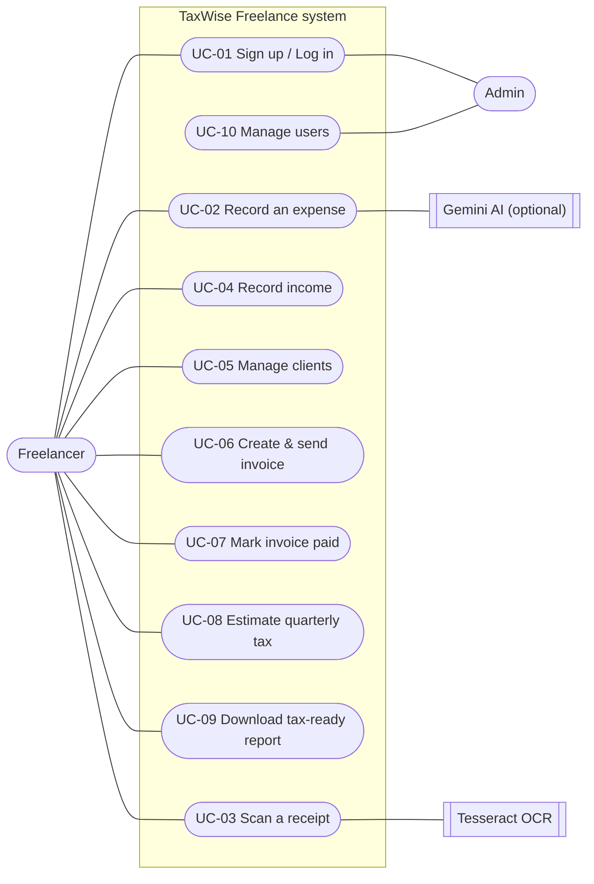

# 1. Summary

This week I wrote the **Software Requirements Specification (SRS)** in the IEEE 830 format. It describes exactly what the app must do (functional requirements), how well it must do it (non-functional requirements), and how users interact with it (use cases).

<b>14</b>functional requirements

<b>10</b>use cases + diagram

<b>10</b>measurable quality targets

| Task from the plan | Status |
| --- | --- |
| Write a formal IEEE 830 SRS document | Done |
| Write formal use case specifications | Done — 10 use cases |
| Draw the system use case diagram | Done (section 4) |
| Set measurable non-functional requirements (speed, security, uptime) | Done — 10 targets |

# 2. SRS structure (IEEE 830)

1. **Introduction** — purpose, scope, definitions (e.g. *deduction*, *OCR*, *self-employment tax*), references.
2. **Overall description** — who the users are, where the app runs, limits and assumptions.
3. **Specific requirements** — functional requirements, tax rules, outside systems, quality targets.
4. **Use cases** — step-by-step descriptions of how each user goal is reached.

**Scope in one line:** a web app where freelancers scan receipts, track expenses and income, send invoices, estimate quarterly tax and download tax-ready PDF reports. It does **not** file tax returns, move money, or connect to bank accounts.

# 3. Functional requirements

| ID | The system shall... |
| --- | --- |
| FR-01 | Let users sign up, log in and log out securely; each user sees only their own data |
| FR-02 | Let users add, edit and delete expenses with date, vendor, amount, category, business-use % and notes |
| FR-03 | Let users upload a receipt photo and read vendor, date and total from it using Tesseract OCR |
| FR-04 | Suggest a tax category for each expense automatically (e.g. hardware, internet, travel, software, meals) |
| FR-05 | Calculate the deductible amount: amount × business-use % × category factor (meals 50%) |
| FR-06 | Let users record income by hand, and add income automatically when an invoice is marked paid |
| FR-07 | Let users manage clients and create invoices with line items, tax, discount and auto numbers (INV-0001) |
| FR-08 | Track invoice status: Draft → Sent → Paid, with Overdue and Void |
| FR-09 | Generate invoices and tax summary reports as PDF files (PDFKit) |
| FR-10 | Estimate quarterly tax: self-employment tax, income tax, QBI deduction, safe-harbour option, due dates |
| FR-11 | Let users log estimated tax payments and show the remaining amount |
| FR-12 | Show a dashboard with totals, charts, unpaid invoices and upcoming deadlines |
| FR-13 | Support search, filters, sorting, CSV import/export and bulk actions on lists |
| FR-14 | Provide an admin portal (admins only) to manage users and view platform statistics |

# 4. Use case diagram

Figure 1 — System use case diagram (UC-03 Scan a receipt includes UC-02 Record an expense)

# 5. Use case specifications

Each use case was written with: actor, starting condition, main steps, other paths, and end result. Two examples:

### UC-03 Scan a receipt

**Actor:** Freelancer · **Before:** user is logged in

1. User clicks **Scan receipt** and uploads a photo.
2. System reads the text with Tesseract OCR.
3. System finds vendor, date and total, and suggests a category.
4. User checks the details and clicks **Save**.
5. System saves the expense with the receipt image.

**Other path:** photo unreadable → system shows a message and the user types the details manually.

### UC-07 Mark invoice paid

**Actor:** Freelancer · **Before:** invoice is Sent or Overdue

1. User opens the invoice and clicks **Mark as paid**.
2. System sets the status to Paid with the payment date.
3. System adds one income entry for the invoice total.
4. Dashboard and tax estimate update.

**Other path:** user clicks twice → still only one income entry is created.

| ID | Use case | Actor |
| --- | --- | --- |
| UC-01 | Sign up / Log in | Freelancer, Admin |
| UC-02 | Record an expense | Freelancer |
| UC-03 | Scan a receipt | Freelancer |
| UC-04 | Record income | Freelancer |
| UC-05 | Manage clients | Freelancer |
| UC-06 | Create & send an invoice | Freelancer |
| UC-07 | Mark an invoice paid | Freelancer |
| UC-08 | Estimate quarterly tax & log payments | Freelancer |
| UC-09 | Download tax-ready summary report | Freelancer |
| UC-10 | Manage users and view statistics | Admin |

# 6. Non-functional requirements (measurable)

| ID | Area | Target |
| --- | --- | --- |
| NFR-01 | Speed | 95% of normal page/API requests answer in **under 300 ms** |
| NFR-02 | Receipt scanning | A receipt is read in **under 10 seconds**; if it fails, manual entry still works |
| NFR-03 | Uptime | App available **99.5%** of the time each month, checked by a health endpoint |
| NFR-04 | Password security | Passwords stored only as **bcrypt hashes (cost 12)**; never in plain text |
| NFR-05 | Sessions | Login token (JWT) in a secure, httpOnly cookie that expires after **7 days** |
| NFR-06 | Attack protection | Max **5 login attempts per 15 minutes**; protection against OWASP Top 10 risks |
| NFR-07 | Data privacy | A user can **never** read or change another user's data |
| NFR-08 | Mobile friendly | Works on screens from **320 px** (phone) to **1440 px** (desktop) |
| NFR-09 | Testing | At least **70% test coverage** on the core logic |
| NFR-10 | Accuracy | All money stored in **whole cents** so totals never have rounding errors |

# 7. Challenges and solutions

| Challenge | Solution |
| --- | --- |
| Tax rules have many small details | Wrote exact formulas and example numbers in the SRS so they can be tested |
| OCR is not always correct | Made it a rule that the user always confirms scanned data (UC-03) |
| A double-click could record income twice | Added a requirement that marking paid is safe to repeat (UC-07) |

# 8. Plan for next week (Week 3)

- Draw the 3-tier architecture diagram (client, API server, database).
- Draw Data Flow Diagrams (Level 0 and Level 1).
- Define the system boundaries and choose the cloud services.
