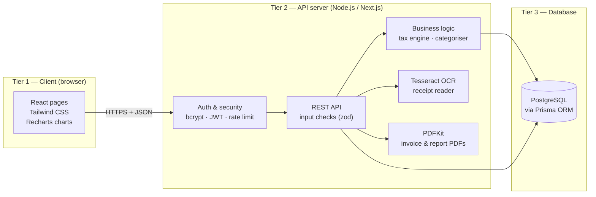
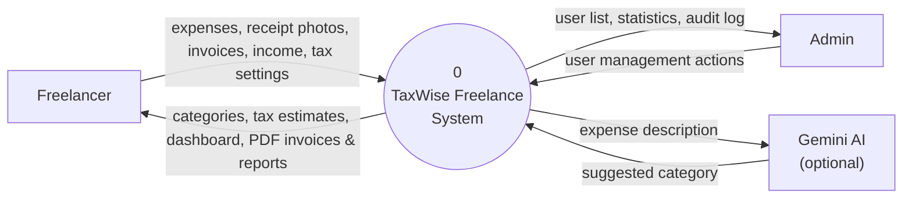
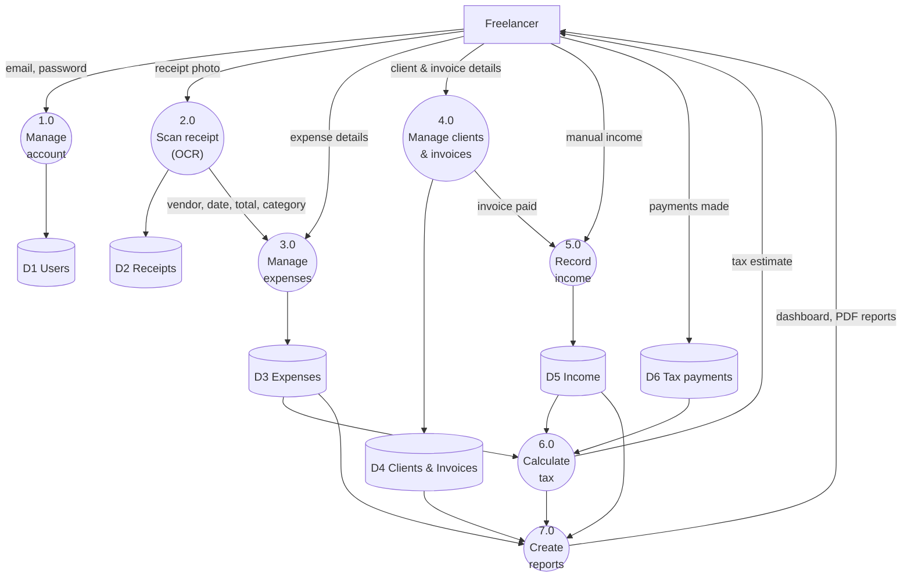
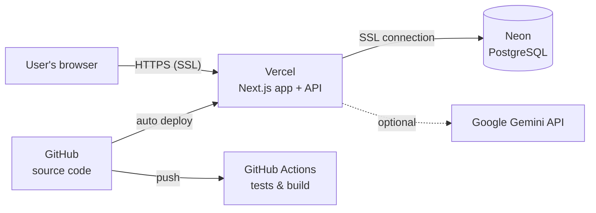

# 1. Summary

This week I designed **how the system is built**: the three layers of the app, how data moves between them, where the system ends, and which cloud services will run it.

| Task from the plan | Status |
| --- | --- |
| 3-tier architecture diagram (Client, API Server, Database) | Done — Figure 1 |
| Data Flow Diagram Level 0 | Done — Figure 2 |
| Data Flow Diagram Level 1 | Done — Figure 3 |
| Define system boundaries | Done — section 5 |
| Justify the cloud infrastructure stack | Done — section 6 |

# 2. Three-tier architecture

The app has three layers. Each layer only talks to the layer next to it.

Figure 1 — 3-tier architecture

| Tier | Technology | Job |
| --- | --- | --- |
| Client | React (Next.js), Tailwind CSS, Recharts | Shows pages, forms and charts in the browser |
| API server | Node.js (Next.js route handlers), TypeScript | Checks who the user is, validates input, runs tax rules, reads receipts (Tesseract OCR), makes PDFs (PDFKit) |
| Database | PostgreSQL with Prisma ORM | Stores users, expenses, receipts, income, clients, invoices and tax payments |

# 3. Data Flow Diagram — Level 0 (context)

Level 0 shows the whole system as **one process** and the outside people and services it exchanges data with.

Figure 2 — DFD Level 0 (context diagram)

# 4. Data Flow Diagram — Level 1

Level 1 opens the system and shows its **main processes** and **data stores**.

Figure 3 — DFD Level 1

# 5. System boundaries

**Inside the system (we build it):** accounts and login, receipt scanning, expenses, income, clients, invoices, tax estimator, dashboard, PDF reports, admin portal.

**Outside the system (we only connect to it or leave it out):**

- **Gemini AI** — optional helper for categories. If it is down, the app uses its own keyword rules.
- **Banks and payment apps** — not connected. Users record payments themselves.
- **Tax authority (IRS)** — the app does **not** file tax returns.
- **Email** — invoices are downloaded as PDF; the app does not send emails.

**Security boundary:** every request passes through the login check. Every database query is filtered by the logged-in user's ID, so one user can never see another user's data.

# 6. Cloud stack and why it was chosen

Figure 4 — Cloud deployment

| Part | Service | Why | Cost |
| --- | --- | --- | --- |
| App + API | **Vercel** | Made for Next.js, free SSL, auto-deploys from GitHub | Free tier |
| Database | **Neon PostgreSQL** | Real PostgreSQL in the cloud, works well with Vercel | Free tier |
| Testing pipeline | **GitHub Actions** | Runs tests and build on every push | Free |
| AI (optional) | **Google Gemini** | Better category suggestions | Free tier / optional |

**Total cost: $0.** Other options compared: Render, Railway, Supabase and Firebase. Firebase was not chosen because it is not a relational database, and our data (invoices, line items, payments) needs relations and transactions.

# 7. Challenges and solutions

| Challenge | Solution |
| --- | --- |
| OCR needs a lot of processing power | Run Tesseract on the server with a time limit; manual entry always available |
| Free cloud databases sleep when unused | Use Neon's pooled connection; the first request may be a little slower |
| Must keep users' data separate | Every table has a user ID and every query is filtered by it |

# 8. Plan for next week (Week 4)

- Draw the database Entity-Relationship Diagram (ERD) with indexes.
- Write the full list of REST API endpoints.
- Design wireframes for the main screens.
