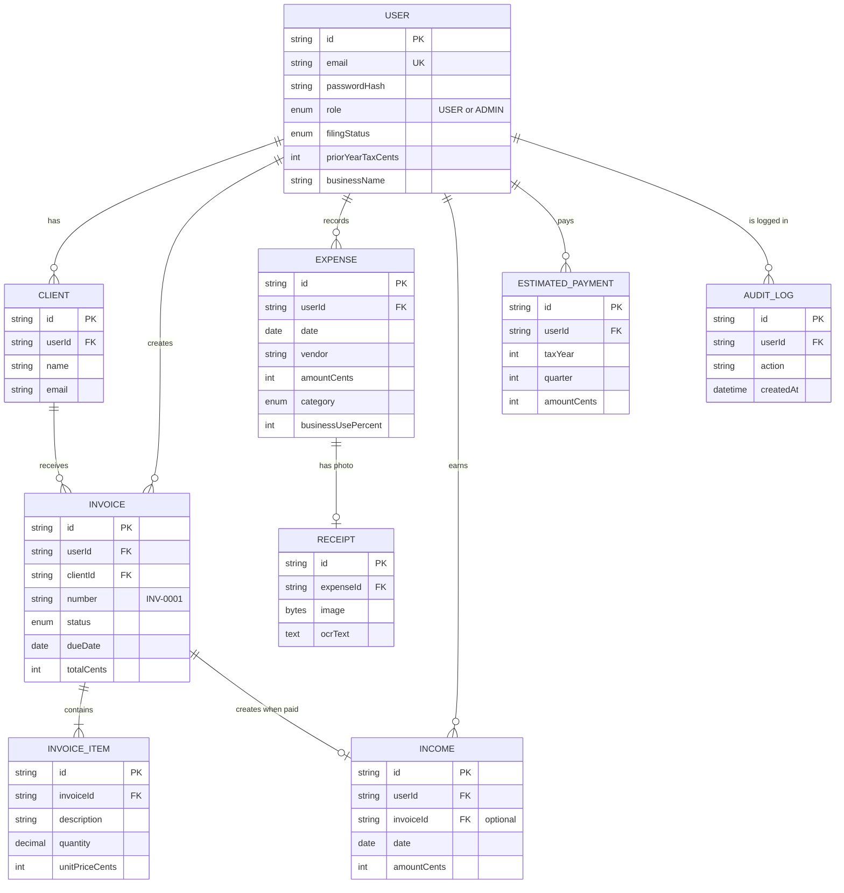

# 1. Summary

This week I designed the **database**, the **API** that the app's screens use to talk to the server, and **wireframes** (simple sketches) of the main screens.

<b>9</b>database tables

<b>30+</b>REST API endpoints

<b>6</b>screen wireframes

| Task from the plan | Status |
| --- | --- |
| Database ERD with index definitions | Done — Figure 1 and section 3 |
| Complete REST API endpoint contracts | Done — section 4 |
| UI wireframes for 4–6 main screens | Done — 6 screens, section 5 |

# 2. Entity-Relationship Diagram (ERD)

Figure 1 — Entity-Relationship Diagram

**Simple rules in the design:**

- **Every table has a `userId`.** This keeps each user's data separate (multi-tenant).
- **Money is stored in cents** (whole numbers), e.g. $12.50 is saved as 1250. This avoids rounding errors.
- **Invoice numbers are unique per user** (INV-0001, INV-0002, ...).
- **One paid invoice = one income row.** The database blocks a second one.

# 3. Indexes

An index makes searching a table fast, like the index at the back of a book. I only added indexes for searches the app really does.

| Table | Index | Why it is needed |
| --- | --- | --- |
| User | `email` (unique) | Find a user quickly at login; stop duplicate accounts |
| Expense | `userId, date` | Show a user's expenses for a date range |
| Expense | `userId, category` | Deductions-by-category chart and filters |
| Invoice | `userId, number` (unique) | Unique invoice numbers per user |
| Invoice | `userId, status` | List unpaid / overdue invoices |
| Invoice | `userId, dueDate` | Upcoming due dates on the dashboard |
| Income | `userId, date` | Income totals for the year and per month |
| Income | `invoiceId` (unique) | Makes sure a paid invoice adds income only once |
| EstimatedPayment | `userId, taxYear, quarter` | Payments made in each quarter |
| AuditLog | `userId, createdAt` | Show recent activity in the admin portal |

# 4. REST API endpoints

All endpoints use JSON. Every endpoint except sign-up, login and health needs the user to be logged in. Errors always look the same: `{ "error": { "code", "message" } }`.

| Area | Method & path | What it does |
| --- | --- | --- |
| Auth | `POST /api/auth/signup` | Create an account |
| Auth | `POST /api/auth/login` · `POST /api/auth/logout` | Log in (sets secure cookie) / log out |
| Auth | `GET /api/auth/me` | Who is logged in |
| Settings | `GET` · `PATCH /api/settings` | Tax profile and business details |
| Expenses | `GET` · `POST /api/expenses` | List (search, filter, sort, pages) / add |
| Expenses | `GET` · `PATCH` · `DELETE /api/expenses/:id` | View / edit / delete one expense |
| Receipts | `POST /api/receipts/scan` | Upload a receipt photo; returns vendor, date, total, category |
| Receipts | `GET /api/receipts/:id` | View the saved receipt photo |
| Income | `GET` · `POST /api/income`, `PATCH` · `DELETE /api/income/:id` | Manage income |
| Clients | `GET` · `POST /api/clients`, `PATCH` · `DELETE /api/clients/:id` | Manage clients |
| Invoices | `GET` · `POST /api/invoices`, `GET` · `PATCH` · `DELETE /api/invoices/:id` | Manage invoices; change status (e.g. mark paid) |
| Invoices | `GET /api/invoices/:id/pdf` | Download the invoice as PDF |
| Tax | `GET /api/tax/estimate?year=2026` | Full tax estimate with quarterly schedule |
| Tax | `GET` · `POST /api/estimated-payments`, `DELETE /api/estimated-payments/:id` | Log tax payments made |
| Reports | `GET /api/reports/tax-summary?year=2026` | Download the tax-ready summary PDF |
| Dashboard | `GET /api/dashboard` | Totals, chart data, unpaid invoices, deadlines |
| Admin | `GET /api/admin/users`, `PATCH /api/admin/users/:id` | List users, change role, activate/deactivate |
| Admin | `GET /api/admin/stats` · `GET /api/admin/audit-log` | Platform charts and activity log |
| Health | `GET /api/health` | Is the app and database working? |

**Example — scan a receipt**

Request: `POST /api/receipts/scan` with the photo as form data.
Response: `{ "vendor": "Dell", "date": "2026-10-03", "totalCents": 89900, "suggestion": { "category": "COMPUTER_HARDWARE", "confidence": 0.9 } }`

# 5. Wireframes

1 · Login / Sign up

Logo + "Track deductions, send invoices, plan quarterly tax"

Email

Password

Log in&nbsp; Don't have an account? <u>Sign up</u>

2 · Dashboard

Income YTD

Expenses

Deductions

Tax owed

Chart: income vs expenses by month

Chart: deductions by category

Unpaid invoices

Next tax due: 15 Jan 2027

3 · Expenses + Scan receipt

Scan receipt&nbsp;+ Add expense&nbsp; Search · Category ▾ · Date ▾

Table: date · vendor · category · amount · business % · deductible · receipt

Scan dialog: photo preview → vendor / date / total filled in → category "Hardware (auto)" → <b>Save</b>

4 · Invoice editor

Client ▾

Issue date

Due date

Line items: description · qty · price · amount &nbsp;[+ add line]

Subtotal · discount · tax · <b>Total</b>

Save draft&nbsp;Mark sent&nbsp;Mark paid&nbsp;Download PDF

5 · Tax estimator

Year ▾ · Filing status ▾ · Safe harbour ☐

Breakdown: profit → SE tax → deductions → taxable income → income tax → total

Q1 · Q2 · Q3 · Q4 — due date · amount · paid · remaining

Record payment&nbsp; "Estimates for planning, not tax advice"

6 · Reports / Admin portal

Reports: Year ▾ Quarter ▾ → key totals → <b>Download tax summary PDF</b> · CSV

Admin: charts (sign-ups, invoices, expenses per week)

Admin: users table — role ▾ · active ☑ · audit log

# 6. Challenges and solutions

| Challenge | Solution |
| --- | --- |
| Where to store receipt photos for free | Save them inside PostgreSQL (as bytes) — no paid file storage needed |
| "Overdue" could become out of date if saved | Work it out from the due date each time an invoice is read |
| Keeping screens simple on phones | Each wireframe has a single-column mobile layout; tables become cards |

# 7. Plan for next week (Week 5)

- Set up the Git repository with branch protection and the project folders.
- Connect to the PostgreSQL database and run the first migration.
- Build secure sign-up and login (bcrypt password hashing, JWT session cookie).
