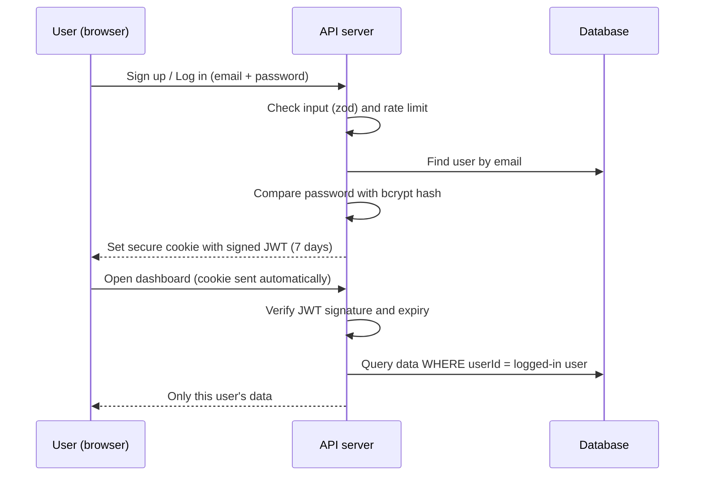

# 1. Summary

This week I set up the real project: the code repository, the folder structure, the database connection, and a **secure login system** where every user only sees their own data.

<b>4</b>auth endpoints (sign up, log in, log out, me)

<b>29</b>automated tests passing

<b>49</b>live smoke-test checks passing

| Task from the plan | Status |
| --- | --- |
| Initialise Git repository with branch protection | Done — GitHub repo, `main` branch protected |
| Configure directory scaffolding | Done — Next.js + TypeScript project structure |
| Verify database connection | Done — PostgreSQL connected, first migration applied, health check |
| Secure multi-tenant authentication (sign up, login, bcrypt, JWT) | Done |

# 2. Repository and branch protection

- Code is on GitHub: **github.com/SohaibRamzan01/taxwise-freelance** (public, so the supervisor can view it).
- The `main` branch is protected: changes must come through a pull request, and force-pushing or deleting the branch is blocked.
- Secrets (database password, JWT secret) are kept in a `.env` file that is **never** uploaded. A safe `.env.example` shows which settings are needed.

# 3. Project structure

| Folder | What is inside |
| --- | --- |
| `src/app/` | Pages (login, sign up, dashboard, expenses, invoices, ...) and API routes (`src/app/api/...`) |
| `src/components/` | Reusable screen parts (app layout, forms, brand) |
| `src/lib/` | Core logic with no UI: login security, database access, validation, (later) tax engine |
| `prisma/` | Database schema, migrations and demo data |
| `docs/` | Design documents from Weeks 1–4 |

**Tools used:** Next.js 16 (React + Node.js), TypeScript, Tailwind CSS, Prisma 7, PostgreSQL, Vitest for tests, ESLint for code style.

# 4. Database connection

- PostgreSQL database created and connected through Prisma.
- The first **migration** created all the tables from the Week 4 ERD (users, clients, invoices, invoice items, expenses, income, tax payments, audit log).
- The database itself blocks one user's invoice from pointing to another user's client (composite foreign keys).
- `GET /api/health` reports whether the app and the database are working.
- A seed script adds demo data (clients, invoices, expenses, income) for testing and demos.

# 5. How login works

Figure 1 — Login and protected request flow

| Security feature | How it is done |
| --- | --- |
| Password storage | **bcrypt** hash with cost 12 — the real password is never saved |
| Session | **JWT** (HS256) in a cookie that is httpOnly, Secure, SameSite=Lax, expires in 7 days |
| Brute-force protection | Limits on login and sign-up attempts per IP and email |
| Fake requests from other sites | Origin check on every request that changes data |
| Protected pages | Middleware sends logged-out users to the login page |
| Multi-tenant | Every query is filtered by the logged-in user's ID |
| Roles | USER and ADMIN; admin pages check the role on the server |
| Audit log | Sign-up, login and logout are recorded |
| Safe errors | Wrong email and wrong password give the **same** message, so attackers learn nothing |

# 6. Testing and verification

| Check | Result |
| --- | --- |
| Lint (code style) | Passed |
| Type check (TypeScript strict) | Passed |
| Automated tests | **29 passed** (password hashing, tokens, validation, routes, middleware) |
| Test coverage on core logic | **97.6% lines** (target was 70%) |
| Production build | Passed |
| Live smoke test against the running app | **49 checks passed** — sign up, login, logout, cookies, protected pages, rate limiting, cross-user blocking |

# 7. Challenges and solutions

| Challenge | Solution |
| --- | --- |
| Free GitHub accounts don't enforce branch protection on private repos | Made the repository public (it contains no secrets) |
| The existing database server on port 5432 had different login details | Used a separate project database on port 5433, with settings kept in `.env` |
| Next.js warns that `middleware` will be renamed to `proxy` | Works correctly now; will rename in a later update |

# 8. Plan for next week (Week 6)

- Build the tax calculation engine (self-employment tax, income tax, quarterly payments).
- Build expenses, income, clients and invoices with full server-side validation.
- Connect everything end to end: screen → API → database.
