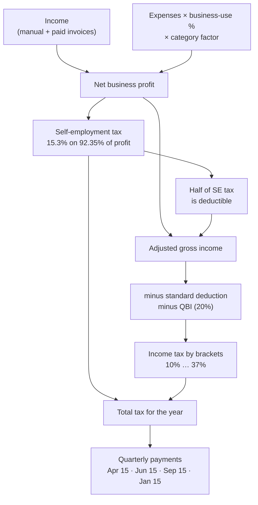

# 1. Summary

This week the **main working parts of TaxWise** were built: the tax calculation engine, receipt scanning with Tesseract OCR, automatic categories, invoices, and PDF reports. Every screen is now connected to the API and the database, so a user can go from a receipt photo to a tax-ready PDF report.

<b>170</b>automated tests passing

<b>99%</b>test coverage on core logic

<b>30+</b>working API endpoints

| Task from the plan | Status |
| --- | --- |
| Build the main business calculation engine | Done — 2026 US tax engine with a line-by-line breakdown |
| Server-side input validation and error handling | Done — every API input checked with zod; one error format |
| End-to-end vertical slice (screen → API → database) | Done — all main screens work with real data |

# 2. The tax calculation engine

The engine takes a user's income, expenses and settings and works out how much tax they owe and how much to pay each quarter.

- **Pure functions:** no database or internet inside the engine, so the same input always gives the same answer and it is easy to test.
- **Money in cents:** all amounts are whole numbers of cents, so there are no rounding mistakes.
- **Rules as data:** the 2026 tax rules (brackets, standard deduction, Social Security limit) live in one file, `rules/2026.ts`. A new year means adding a new file.

Figure 1 — How the tax engine calculates a quarterly payment

**Hand-checked example** (single filer, $100,000 business profit) — the test expects exactly these numbers:

| Step | Amount |
| --- | --- |
| Self-employment tax (92.35% × 15.3%) | $14,129.55 |
| Half of SE tax (deduction) | $7,064.78 |
| Taxable income after standard deduction and QBI | $61,468.18 |
| Federal income tax (10% / 12% / 22% brackets) | $8,235.00 |
| **Total tax for the year** | **$22,364.55** |

# 3. Receipt scanning and automatic categories

This is the main feature from the project description: *"automatically categorizes receipts into allowable tax deductions (hardware, internet, travel)"*.

1. The user uploads or photographs a receipt.
2. The server checks the file is a real image (not just its name) and under 5 MB.
3. **Tesseract OCR** reads the text from the image.
4. A parser finds the **vendor**, **date** and **total**.
5. A rules engine suggests a **category** — e.g. Dell → *Computer hardware*, PTCL → *Internet & phone*, Uber → *Travel*.
6. The user checks the details and saves. The receipt photo is stored with the expense.

If the photo cannot be read, the user simply types the details — the app never blocks them.

# 4. Invoices and PDF reports (PDFKit)

- Clients and invoices with line items, discount and tax; numbers like **INV-0001** per user.
- Status flow: Draft → Sent → Paid (plus Overdue and Void). Marking an invoice **Paid** adds exactly one income entry, even if clicked twice.
- **PDFKit** creates a downloadable **invoice PDF** and a **tax-ready summary report** for the year or a quarter: income, expenses and deductions by category (with Schedule C line numbers), net profit, tax estimate and payments made.

# 5. Validation and error handling

| Rule | How it works |
| --- | --- |
| Check every input | Every API request is checked with a **zod** schema; unknown fields are rejected |
| One error format | Errors always look like `{ "error": { "code", "message" } }` |
| Users only see their own data | Every query includes the logged-in user's ID; other users' records return "not found" |
| Safe deletes | Deletes are recorded in the audit log |
| Upload safety | File type checked by its real content (magic bytes), size limit, time limit for OCR |

# 6. The working app (screenshots)

Figure 2 — Dashboard: year-to-date totals, monthly chart, deductions by category, unpaid invoices and tax deadlines

Figure 3 — Expenses: each row shows the amount and the deductible part (business use × category factor)

Figure 4 — Tax estimator: totals, the line-by-line calculation and the quarterly plan

Figure 5 — Invoices with status, PDF download and "Mark paid"

Figure 6 — Reports: choose a year or quarter and download the tax-ready PDF made with PDFKit

# 7. Testing and verification

| Check | Result |
| --- | --- |
| Lint and TypeScript strict check | Passed |
| Automated tests | **170 passed**, including real OCR on sample receipts |
| Coverage on core logic (`src/lib`) | **99%** of lines (target 70%) |
| Production build | Passed |
| Live journey test | Passed — sign up → client → invoice → mark paid → scan receipt → save expense → tax estimate → download PDFs |
| Data separation test | Passed — a second user cannot read, change or delete the first user's records |

# 8. Challenges and solutions

| Challenge | Solution |
| --- | --- |
| OCR text is messy (wrong letters, extra lines) | The parser looks for "TOTAL" / "AMOUNT DUE" lines first, then the largest amount; the user always confirms |
| Two clicks on "Mark paid" could add income twice | The database allows only one income row per invoice, and the update runs in one transaction |
| Tesseract and PDFKit need extra files on the server | Configured the build to include the OCR language data and PDF fonts, and checked they are bundled |

# 9. Plan for next week (Week 7 — Midterm)

- Run a full end-to-end test of the user journey and prepare demo data.
- Write the mid-term progress report and slide deck.
- Give the live demonstration to the supervisor.
