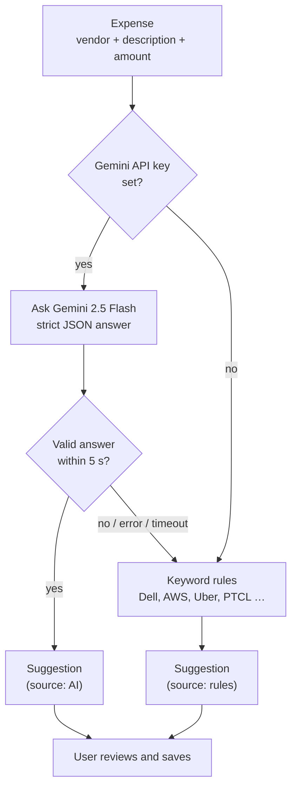

# 1. Summary

This week added the **secondary features** around the core: **Google Gemini AI** for smarter expense categories (with a safe fallback when AI is not available), a **daily background job** with in-app notifications, and power-user tools — **search, filters, bulk actions, and CSV import/export**.

<b>5 s</b>AI time limit, then automatic fallback

<b>1×/day</b>background job (cleanup + reminders)

<b>3</b>bulk / data tools: bulk edit, CSV in, CSV out

| Task from the plan | Status |
| --- | --- |
| Integrate external APIs (Gemini AI) | Done — expense category suggestions |
| Build background tasks | Done — daily job: receipt cleanup, overdue-invoice and tax-deadline reminders |
| Error fallbacks | Done — AI falls back to rules; OCR falls back to manual entry |
| Search, filtering, batch operations | Done — global search, filters, sorting, pages, bulk delete / re-categorise, CSV import & export |

# 2. Gemini AI categorisation with a fallback

When a user adds an expense or imports a CSV file, the app suggests a tax category.

Figure 1 — AI suggestion with automatic fallback; the user is never blocked

- **Strict answer format:** Gemini must reply with a fixed JSON shape (category + confidence). The answer is checked with **zod**; anything else is ignored.
- **Time limit:** 5 seconds for the whole call. Slow, failed or invalid answers fall back to the keyword rules.
- **Always reviewed:** the suggestion shows its source ("AI" or "rules") and confidence; the user decides.
- **Cost control:** the API key is optional. Without it the app uses the rules engine, which already covers common vendors.

# 3. Background job and notifications

A scheduled job runs **once a day at 06:00 UTC** (Vercel Cron) on `/api/cron/daily`. It only runs with a secret token.

| What the job does | Why |
| --- | --- |
| Deletes receipt scans that were never saved (older than 24 hours) | Keeps the database small and private |
| Creates a notification when an invoice becomes **overdue** | Reminds the user to chase payment |
| Creates a notification **14 days before** each quarterly tax due date | Reminds the user to pay on time |
| Writes a job summary to the audit log | Admins can see that the job ran |

Running the job twice never creates duplicate notifications (a database lock plus unique keys). Users see a **bell icon** with an unread count and can mark items as read.

# 4. Search, filters and bulk actions

| Tool | What it does |
| --- | --- |
| Global search | One search box finds expenses, clients and invoices — only the user's own |
| Filters & sorting | By category, status, date range; sort by date or amount; page by page |
| Bulk actions | Select many expenses → delete or change category in **one** request, recorded in the audit log |
| CSV export | Download expenses or income for the current filter; spreadsheet formula injection is blocked |
| CSV import | Upload a CSV → preview with errors shown per row → AI/rules suggest missing categories → confirm |

Figure 2 — Expenses page with Scan receipt, Import CSV, Export CSV, search, filters and row selection for bulk actions

# 5. About messaging, maps and payments

The plan lists messaging, maps and payment processing as example APIs. For TaxWise:

- **Messaging** is covered by **in-app notifications** from the background job.
- **Maps** are not needed for tax deductions or invoices.
- **Payment processing** is outside the scope agreed in the SRS: the app records payments but does **not move money**, to keep financial risk and compliance low.

# 6. Testing and verification

| Check | Result |
| --- | --- |
| AI tests (mocked Gemini) | Success, HTTP errors, timeouts, invalid JSON and missing key — all fall back correctly |
| Background job tests | Cleanup, reminders, no duplicates on re-run, rejected without the secret |
| CSV tests | Quoted fields, bad rows reported, formula escaping, tenant isolation |
| Bulk action tests | Only the user's own rows can be changed; audit entries written |
| Total automated tests at the end of the week | 229 → 270 passing |

# 7. Challenges and solutions

| Challenge | Solution |
| --- | --- |
| AI can be slow, down, or return nonsense | 5-second limit, strict JSON schema check, and a rules fallback |
| Cron jobs can run twice | Advisory lock and unique notification keys make the job safe to repeat |
| CSV files can carry spreadsheet formulas (CSV injection) | Exported cells that start with `=`, `+`, `-`, `@` are escaped |

# 8. Plan for next week (Week 9)

- Build the protected admin portal with role-based access control.
- Add analytics charts and the audit log viewer.
- Polish the user experience: mobile layout, toast notifications, loading and error states.
