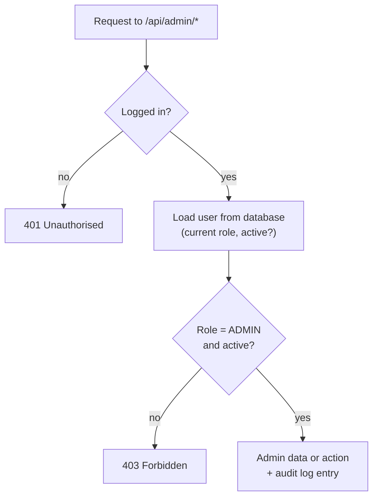

# 1. Summary

This week added a **protected admin portal** (only users with the ADMIN role can open it) with **analytics charts** and an **audit log**, and polished the experience for normal users: **mobile layout, toast messages, confirmations, loading and error pages**.

<b>RBAC</b>admin role checked on the server for every admin request

<b>3</b>weekly analytics charts + totals

<b>320 px+</b>works on phone screens with no sideways scrolling

| Task from the plan | Status |
| --- | --- |
| Protected Admin Portal with Role-Based Access Control | Done |
| Telemetry charts and governance analytics | Done — 3 weekly charts, platform totals, audit log viewer |
| Responsive mobile layouts | Done — mobile menu, tables become cards |
| Toast notifications | Done — success and error toasts for every change |

# 2. Admin portal and role-based access control

Figure 1 — Every admin request checks the user's current role in the database

- **Server-side checks:** every admin API checks the role **from the database**, not just from the login token, so a role change takes effect immediately.
- **Users page:** search and page through users, change a user's role, enable or disable an account.
- **Safety rule:** an admin cannot demote or disable **themselves** (prevents locking everyone out).
- **Audit log viewer:** shows logins, deletes, bulk actions, role changes and background job runs, with filters.

Figure 2 — Admin overview: platform totals and weekly activity charts

# 3. Analytics (telemetry) charts

| Chart | What it shows |
| --- | --- |
| Weekly activity | Sign-ups, active users and expenses logged per week (last 12 weeks) |
| Invoices created per week | How much invoicing is happening |
| Invoice value per week | Total value of invoices created |
| Platform totals | Accounts, active users (30 days), invoices, expenses |

Each chart also has a **data table** for screen-reader users.

# 4. User experience polish

| Improvement | Details |
| --- | --- |
| Mobile layout | Menu button on small screens; wide tables turn into easy-to-read cards; checked with no sideways scrolling at 390 px |
| Toast messages | A short message after every save, delete, import or error |
| Confirm dialogs | Deleting, voiding or un-paying asks "are you sure?" first |
| Loading & error states | Skeleton loaders, friendly 404 and error pages, empty-state messages |
| Accessibility | Labels on all inputs, visible keyboard focus, "skip to content" link |
| Clear wording | Tax figures use the same labels on every page with a one-line explanation |

Figure 3 — Dashboard (left) and Expenses as cards (right) on a phone-sized screen

# 5. Visual QA

All 13 screens were opened in a real browser at desktop (1366 px) and phone (390 px) size and checked for layout problems and console errors. Issues found and fixed: the sidebar stopping half-way down long pages, a missing "deductible" column on expenses, a confusing quarterly status, a missing site icon, and two tax figures that looked contradictory.

# 6. Testing and verification

| Check | Result |
| --- | --- |
| Admin access tests | Normal users get 403 on every admin route; disabled or demoted admins lose access immediately |
| Self-protection tests | Admin cannot demote or disable their own account |
| Visual QA | 13 screens × 2 sizes — all load, no console errors, no horizontal overflow |
| Automated tests | All passing; production build passing |

# 7. Challenges and solutions

| Challenge | Solution |
| --- | --- |
| A login token could still say "admin" after the role was removed | Admin checks read the current role from the database on every request |
| Charts are hard for screen-reader users | Each chart has a matching data table |
| Wide tables do not fit on phones | Tables switch to a card layout below tablet width |

# 8. Plan for next week (Week 10)

- Raise and enforce test coverage on the core logic (target ≥ 70%).
- Run static security scans and fix dependency vulnerabilities.
- Review every input against the OWASP Top 10 risks.
