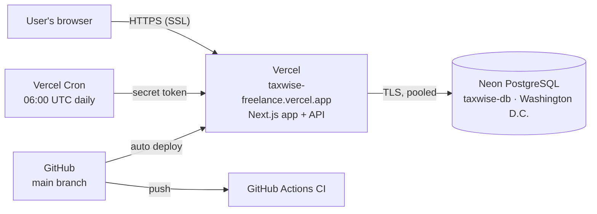

# 1. Summary

TaxWise Freelance is **live on the internet** at **https://taxwise-freelance.vercel.app** with SSL (HTTPS). Every push to GitHub runs an automated **CI pipeline** and then **deploys automatically**. A full end-to-end test against the live site passes **14 of 14 steps**. Running cost: **$0**.

<b>14/14</b>live end-to-end steps passing

<b>~1.5 min</b>CI pipeline per push

<b>$0</b>monthly hosting cost

| Task from the plan | Status |
| --- | --- |
| Deploy to a live public URL (Vercel / cloud database) with SSL | Done — Vercel + Neon PostgreSQL, HTTPS |
| Automated GitHub Actions CI pipeline | Done — runs on every push and pull request |
| Verify production health checks | Done — `/api/health` OK; live smoke test 14/14 |

# 2. Live system

Figure 1 — Production setup

| Part | Service | Plan / cost |
| --- | --- | --- |
| App + API + SSL | Vercel (Hobby) | Free |
| Database | Neon PostgreSQL, created through Vercel's Neon integration | Free (1 GB) |
| CI pipeline | GitHub Actions (public repository) | Free |
| Daily background job | Vercel Cron | Free |

**Configuration:** the database addresses were added automatically by the Neon integration (no passwords copied by hand). Secrets (`JWT_SECRET`, `CRON_SECRET`) are stored as encrypted Vercel environment variables, never in Git. Preview deployments use their own **database branch**, so tests never touch live data.

Figure 2 — The live site at https://taxwise-freelance.vercel.app

# 3. CI/CD pipeline

Every push to `main` runs these steps on GitHub Actions (Node 22 + a PostgreSQL 17 container):

1. Install exact dependency versions (`npm ci`)
2. Generate the database client and apply all migrations
3. Lint and TypeScript type check
4. All automated tests with the coverage gate (≥ 70%)
5. Production build
6. Bundle check — runs real OCR using only the files that will be deployed
7. Full HTTP journey test against the built app (real OCR and PDF)

If all checks pass, Vercel builds and deploys the same commit. The production build runs `prisma migrate deploy`, so the database is always up to date.

Figure 3 — A green CI run on GitHub Actions (1 min 26 s)

# 4. Production verification

| # | Live test step | Result |
| --- | --- | --- |
| 1 | Health check (app + database) | PASS |
| 2–4 | Sign up, create client, create invoice | PASS |
| 5 | Mark paid → exactly one income entry | PASS |
| 6 | **Scan a receipt with real Tesseract OCR** | PASS |
| 7 | Save expense, fetch private receipt photo | PASS |
| 8–9 | Tax estimate, tax-ready PDF (PDFKit) | PASS |
| 10 | Notifications; admin pages blocked for normal users | PASS |
| 11–14 | Cleanup and logout | PASS |

**Security headers on the live site:** Strict-Transport-Security (HSTS), Content-Security-Policy, X-Frame-Options: DENY, X-Content-Type-Options: nosniff. The daily job rejects requests without its secret (401).

# 5. Challenges and solutions

| Challenge | Solution |
| --- | --- |
| Receipt scanning worked locally but failed on Vercel (error 422) | Vercel uploads only the files it detects; three OCR files were missing. They are now listed in the build config, and a new check runs OCR using **only** the deployed files, so this cannot slip through again |
| The real OCR error was hidden | OCR failures are now logged as one structured line (no images or user data) |
| Database warning about SSL modes | The connection string is normalised to full certificate verification |
| Vercel limits uploads to 4.5 MB; phone photos are bigger | Photos are resized in the browser before upload |
| Preview builds could change live data | Neon creates a separate branch for preview deployments |

# 6. Plan for next week (Week 12)

- Write the final FYP report following the academic rubric.
- Prepare the final presentation slides and the live defense demo.
- Final polish from supervisor feedback.
